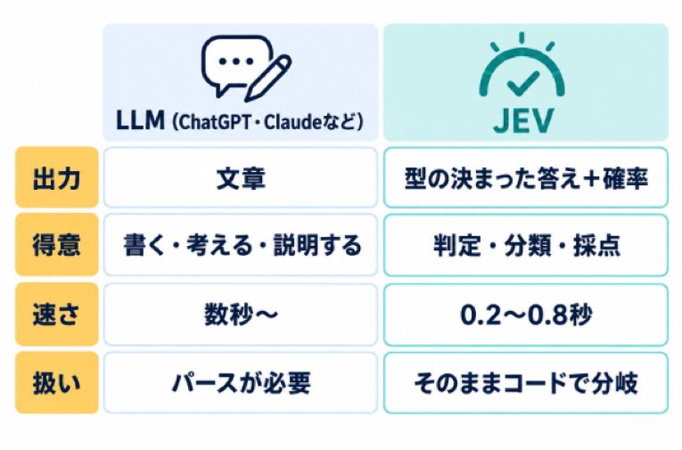
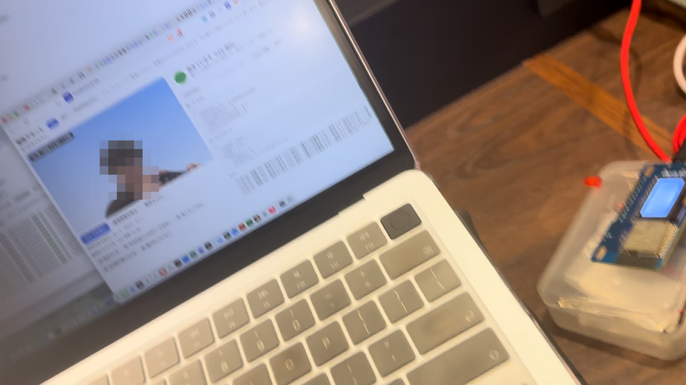
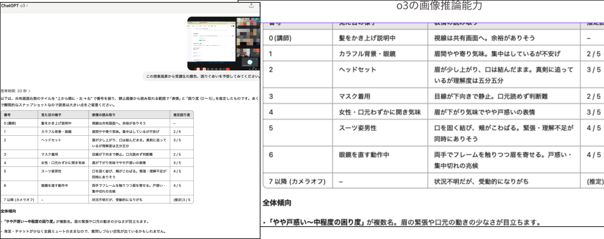
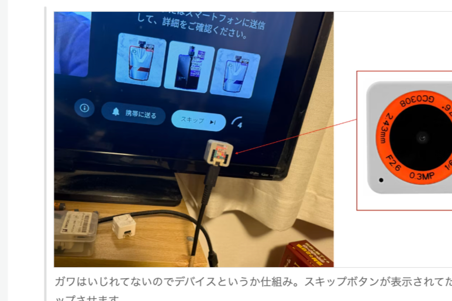

<!-- _class: title -->

# Jevでマイクロスリープ判定（ショートスリーパー）


<div class="lt-author">
  
  <p class="lt-caption">菅原のびすけ</p>
  <p class="lt-caption">@n0bisuke</p>
</div>
<p class="lt-tagline lt-tag">#IoTLT</p>

---

<!-- _class: profile -->

<div class="lt-profile-head">
  <p class="lt-name">菅原 のびすけ</p>
</div>

<div class="lt-profile-body lt-body">
  <p><b>- <span class="lt-strong">IoTLT</span>（国内最大のIoTコミュニティ）主催</b></p>
  <p class="lt-strong">- この夏はみこしを3回担いでます</p>
</div>

---

<!-- _class: stack -->

Jev

最近話題のスマート分類機

爆速、安い、そこそこかしこ

話さないLLM?

---

# 判定専用AI JEV

 

> 引用元: AGIラボさん https://agi-labo.com/articles/n746a127b4074

---

# Jevの使い所（所感）

- 判断をさせたいけどifだと難しい
- 生成AIに任せるとスピードが遅いしコストも高い

**IoT文脈でもそんなリッチなのいらないから分類だけやらせたいって話はあった**

---

<!-- _class: small -->

# Jevマイクロスリープ判定器を作ってみた

- ネタが分からない人向け
  - ショートスリーパー堀大輔
  - 本人「1日30分睡眠で17年間元気です」
  - 世の中「うそつくな」
  - 本人「1日30分睡眠で1週間配信して**寝なくても元気なこと証明します**」
    - => 配信中めちゃ寝ててネットのおもちゃに
      - **「寝てましたよね？」「いいえ、マイクロスリープです。」**

---

# 「寝てましたよね？」「いいえ、マイクロスリープです。」

 

---



---

<!-- _class: flow -->

# Jevマイクロスリープ判定器を作ってみた

カメラ

↓ ローカルで高速に特徴量抽出

目の閉眼時間・まばたき回数・顔検出品質

↓ 5秒ごとにJSON化

**Jev**

↓

通常／注意／寝ている（マイクロスリープ）／観測不足

↓

画面警告・ビープ・obniz LED

---

<!-- _class: lines -->

# （堀大輔クラスの）マイクロスリープは判定が難しい

If/else => 割とむずい

LLM => 判定が遅い。マイクロスリープ判定が厳しい

Jev => 判定が早い。*スマート！*

---

<!-- _class: small-code -->

```js
const result = await env.AI.run("typesafe/jev", {
  state: {
    eyesClosedRatio: 0.72,        // ← MediaPipeの目情報から計算
    longestClosureSeconds: 3.8,   // ← MediaPipe + JavaScriptで集計
    currentClosureSeconds: 2.4,   // ← JavaScriptで計測
    blinkCount: 4,                // ← MediaPipeの目情報から計算
    trackingQuality: 0.93,        // ← MediaPipeの検出品質
    observationSeconds: 5,        // ← JavaScript側の観測時間
  },
  questions: {
    isAsleep: {                   // ← Jevに質問
      type: "noul",
      instructions: "Is this person likely asleep based on the eye-closing signals?",
      criteria: {
        true: "The eyes stay closed for several seconds and blinking has stopped.",
        false: "The eyes open normally, or the evidence is insufficient.",
      },
    },
    drowsinessLevel: {            // ← Jevに質問
      type: "score",
      instructions: "How drowsy is this person based only on the observed signals?",
      criteria: ["Awake", "Getting drowsy", "Very drowsy", "Asleep"],
    },
  },
});
```

---

<div class="lt-pair">
  <div class="lt-pair-col">
    <p class="lt-body">Mediapipe</p>
    <pre class="lt-codeblock lt-code">state: {
  eyesClosedRatio: 0.72,
  longestClosureSeconds: 3.8,
  currentClosureSeconds: 2.4,
  blinkCount: 4,
  trackingQuality: 0.93,
  observationSeconds: 5,
}</pre>
  </div>
  <div class="lt-lines lt-body">
    <p>5秒間の観測中、</p>
    <p>目を閉じていた割合が72%、</p>
    <p>最長で3.8秒連続して目を閉じている。</p>
    <p>検出品質は93%で、観測データは信頼できそう。</p>
    
  </div>
</div>

---

<div class="lt-pair">
  <div class="lt-pair-col">
    <p class="lt-body">Jev側は質問と照らし合わせる</p>
    <pre class="lt-codeblock lt-code">isAsleep: {
  type: "noul",
  criteria: {
    true:
      "The eyes stay closed for several
      seconds and blinking has stopped.",
    false:
      "The eyes open normally, or the
      evidence is insufficient.",
  },
}</pre>
  </div>
  <div class="lt-arrow"></div>
  <div class="lt-pair-col">
    <p class="lt-body">判断結果</p>
    <pre class="lt-codeblock lt-code">{
  "isAsleep": {
    "noul": 0.91
  },
  "drowsinessLevel": {
    "score": 0.82
  }
}</pre>
  </div>
</div>

---

# Jevの3タイプ

| type | 用途 | 返り値 |
| --- | --- | --- |
| `noul` | Yes / No判断 | `0〜1` の確率 |
| `choice` | 選択肢から1つ選ぶ | 選択結果・confidence |
| `score` | 段階評価 | スコア・confidence |

---

# 画像認識はローカルで高速に行い、Jevには「**この状態は眠気なのか、マイクロスリープなのか**」という解釈だけを任せる

 

---

# 元々、生成AIの画像推論で授業の様子解析とかで使えそう雰囲気はあった



> **=> リアルタイムフィードバックのようなものはできそう**

---

# 過去に作ったYouTube広告スキッパー

 

> **画像入力ができる訳ではないのでパラメータ抽出はTeachable Machineでやりつつ、判断はJevに任せるなどができそう**

---

<!-- _class: small -->

# まとめ

- Jevを使ってマイクロスリープ判定器作ってみた
- **Jev ifとLLMの間くらいに使える**
- **IoTとか電子工作でLLMまでは要らないけど…っていうシーン**結構あると思うのでJev使える箇所多いのでは
