<!-- _class: title-slide -->

# 医療者もガンガン作ろう！ 作って試す時代の身の丈セキュリティ

第2回 ものづくり医療研究会

2026/11/15（日）13:45〜 ふれあい貸し会議室 秋葉原No53

菅原のびすけ @n0bisuke

---

<!-- _class: speaker-profile -->

## 菅原のびすけ

- プロトタイピングスクール「プロトアウトスタジオ」
- デジタルハリウッド大学大学院 非常勤講師
  - プロダクトプロトタイピング
- ソフトウェアエンジニア出身

個人活動

- IoTLT 主催
- Developers Summit 2025 ベストスピーカー 1位
- LINE API Expert / Microsoft MVP / IBM Champion

---

<!-- _class: current-topic -->
<!-- _footer: 1. 医療者が作れる時代と、現場で起きたこと -->

## 医療者がAIでアプリを作れる時代です

### AIで色々作れますね

- 受付・順番待ちシステム
- 問診フォーム
- 院内の業務改善アプリ

などなど

<!-- 生成AIでいろいろ作れる時代になってきました。医療者は現場のことを分かっているから、自分で作れる。これがすごくいいことだと思うんですよね。もっともっと作って、インチキ開発会社を駆逐していってほしいです。 -->

---

<!-- _class: source-cards current-topic -->
<!-- _footer: 1. 医療者が作れる時代と、現場で起きたこと -->

## 医療者は、現場の困りごとから作っている

<article class="gl-source"><strong class="t-body">院内LANで使う呼び出しシステム</strong>
産院の院長がChatGPTに相談しながら作成。投稿では実際の呼出し画面を紹介しています。
<small class="t-note"><a href="https://x.com/A_Mochizuki/status/2111079943400808872">産院のいんちょ / X / 2026年10月16日</a></small></article>
<article class="gl-source"><strong class="t-body">外来の前・中・後を助ける3つのツール</strong>
もいせん受講生の整形外科医が、LINE問診・カルテ音声入力・LINEセルフケア案内を制作。
<small class="t-note"><a href="https://note.com/dr_grid/n/nb44daadafdbf">Drグリッド / note / 2026年7月8日</a></small></article>

<!-- 医セン界隈でも、自分で作る人が出てきています。産院の先生が受付・順番待ちのシステムを作った例や、もいせん受講生が外来で使うツールを作った例があります。 -->

---

<!-- _class: link-cards current-topic -->
<!-- _footer: 1. 医療者が作れる時代と、現場で起きたこと -->

## サイバー攻撃や情報漏えいが続き、世の中も敏感に

<!-- card: https://www.watch.impress.co.jp/docs/news/2144279.html -->
<article class="gl-linkcard" data-card="https://www.watch.impress.co.jp/docs/news/2144279.html">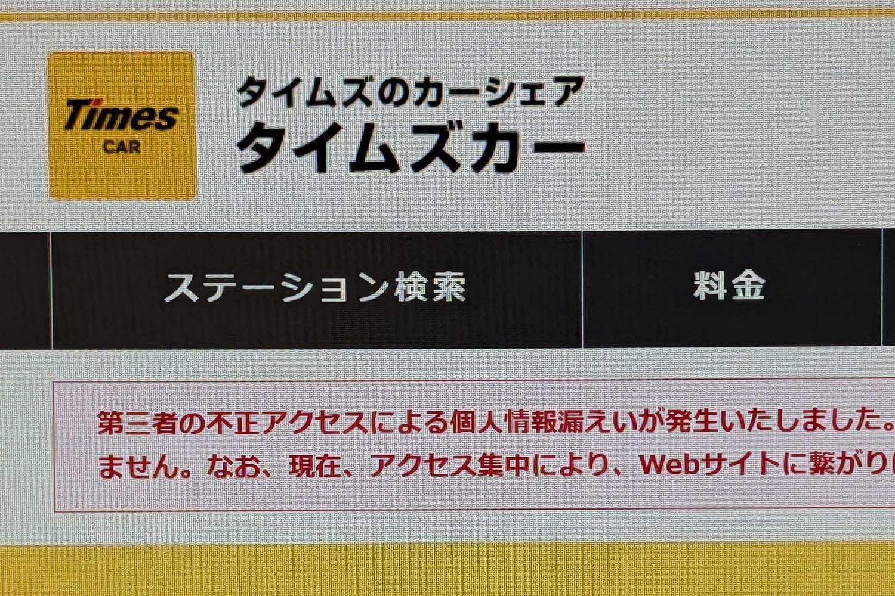<strong class="t-sub"><a href="https://www.watch.impress.co.jp/docs/news/2144279.html">タイムズカーの情報漏洩、免許証など本人確認書類流出は160万件</a></strong><small class="t-note gl-muted">Impress Watch / 2026-09-29</small></article>

<!-- 最近、情報漏えいやサイバー攻撃の話が出ていて、世の中もかなり敏感になっています。こういう状況で、現場で作ったシステムにも「セキュリティ大丈夫？」という声が来る。次に、その作られた背景を見ます。 -->

---

## 作る人へのヤジも、情報漏えいへの不安もある

<!-- _class: text-image current-topic -->
<!-- _footer: 1. 医療者が作れる時代と、現場で起きたこと -->

<!-- 患者さんの情報が漏れたら怖い、という心配はあります。実際に作っている人に「大丈夫なの？」という声が向けられることもあります。 -->

---

## 背景を知らないまま、ヤジが飛んでくることもある

<!-- _class: text-image current-topic -->
<!-- _footer: 1. 医療者が作れる時代と、現場で起きたこと -->

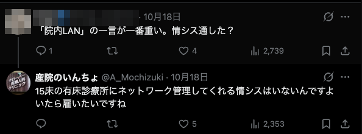

<!-- 作った背景を知らないまま、やいやい言われることもある。ちょっと悲しいですよね。セキュリティへの心配は大事です。でも、作るのをやめるのではなく、気をつけながら作っていきたいです。 -->

---

## 作った背景には、現場の事情がある

<!-- _class: text-image current-topic -->
<!-- _footer: 1. 医療者が作れる時代と、現場で起きたこと -->

<!-- この先生は、既存サービスへの不正アクセスで院内システムが止まって、呼び出しシステムが使えなくなった。そこで自分で作ったんですよね。作ったものだけでは分からない現場の事情があります。 -->

---
<!-- only: 15min,10min -->
<!-- _class: key-message current-topic stage -->
<!-- _footer: 2. 使う人・作る人ができる情報の扱い > 使う側編 -->

## 前提

**もう、データは漏れる前提で考えましょう**

<!-- どこかに渡したデータは漏れるものだと思っておく。漏れないことを前提にするのではなく、使う前から情報を減らして、必要なものだけ扱います。 -->

---

<!-- _class: key-message current-topic -->
<!-- _footer: 1. 医療者が作れる時代と、現場で起きたこと -->

## 今日のメッセージ

- セキュリティを意識して、もっと作って試そう。
- 作ったものと、**設計の工夫を発信しよう。**

<!-- 作るのを止める話ではなくて、セキュリティを意識して作って試す。その上で、作ったものだけじゃなく、どういう設計にしたかも話していきたいです。 -->

---
<!-- only: 15min,10min -->
<!-- _class: qr-prompt current-topic -->
<!-- _footer: 2. 使う人・作る人ができる情報の扱い -->

## アンケートにご協力ください

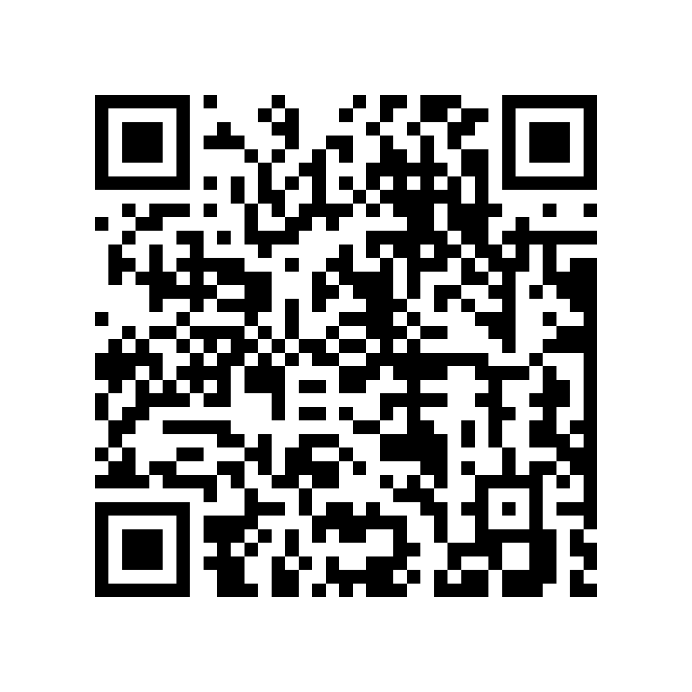

※アンケートにご協力ください

<!-- いったんこちらのアンケートにご協力ください。QRコードのリンク先: https://forms.gle/JNruY64qJqXuh2W58 -->

---

<!-- _class: agenda overview -->

## 今日の流れ

1. 医療者が作れる時代と、現場で起きたこと
2. 使う人・作る人ができる情報の扱い
3. 管理する人が整える、安全に試せる場
4. 作って試し、設計の工夫を発信する

<!-- 今回は作る人向けが中心ですが、使う側と管理する側の話もします。使う人、作る人、管理する人の順で見ていきます。 -->

---

<!-- _class: current-topic -->
<!-- _footer: 2. 使う人・作る人ができる情報の扱い -->

## 作る人を中心に、3つの立場で考える

- 使う人 => 渡す情報を選ぶ
- 作る人 => 集める情報と保存先を考える
- 管理する人 => 安全に試せる場を作る

<!-- 作る人の話を中心にします。まず利用者として情報を渡す時のこと、そのあと作る時の設計、最後に管理する側の環境づくりです。 -->

---

<!-- _class: media-split current-topic -->
<!-- _footer: 2. 使う人・作る人ができる情報の扱い > 使う側編 -->

## 使う側: 必要以上に情報を渡さない

- 必要以上に情報を登録しない
  - 任意の項目は、必要なければ埋めない
- メール：エイリアス / 電話：IP電話
- 住所とかも正直に書く必要はあるか？

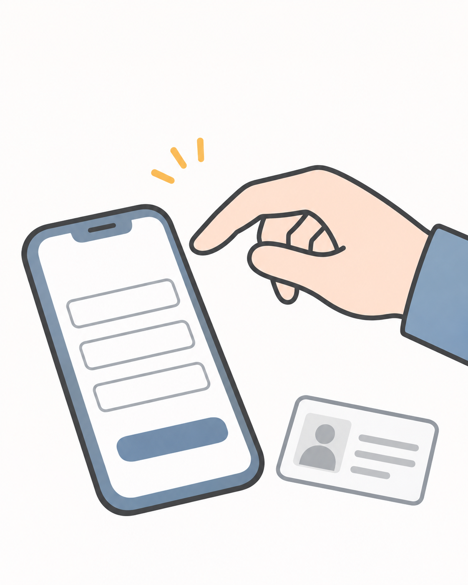

<!-- どこかのシステムに渡したデータは、漏れるものだと思っていた方がいい。メールや電話番号はエイリアスにできないか。住所や生年月日も「これ本当に必要？」と考えます。僕は必要ないと思ったものは、適当に書くこともあります。 -->

---

<!-- _class: diagram current-topic -->
<!-- _footer: 2. 使う人・作る人ができる情報の扱い > 使う側編 -->

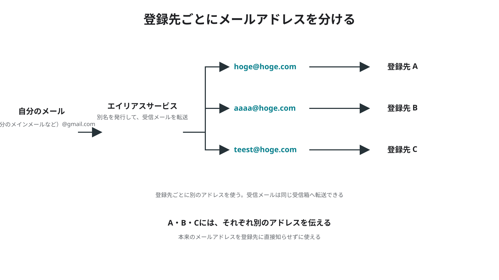

<!-- メールエイリアスを使うと、登録先ごとに別のメールアドレスを使いながら、受信は自分のメールにまとめられます。 -->

---

<!-- _class: diagram current-topic -->
<!-- _footer: 2. 使う人・作る人ができる情報の扱い > 使う側編 -->

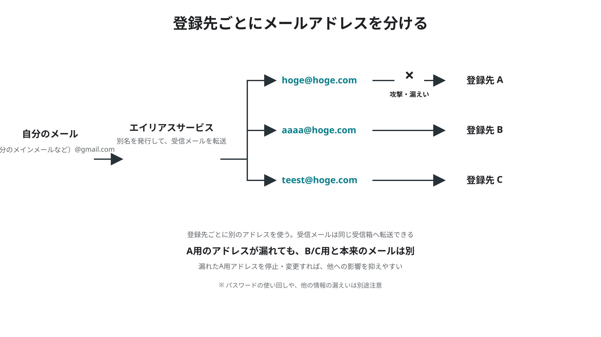

<!-- Aで使った専用アドレスが漏れても、B/C用のアドレスや本来のメールとは分かれているので、他への影響を抑えやすくなります。パスワードの使い回しなど、別の情報まで保護するものではありません。 -->

---

<!-- _class: media-split current-topic -->
<!-- _footer: 2. 使う人・作る人ができる情報の扱い > 使う側編 -->

## 情報、もう一度聞かれていませんか？

- 病院の問診票：マイナ連携後も住所・生年月日
- ホテル受付：予約済みなのに、住所を再記入
- 「本当に必要？」と立ち止まる

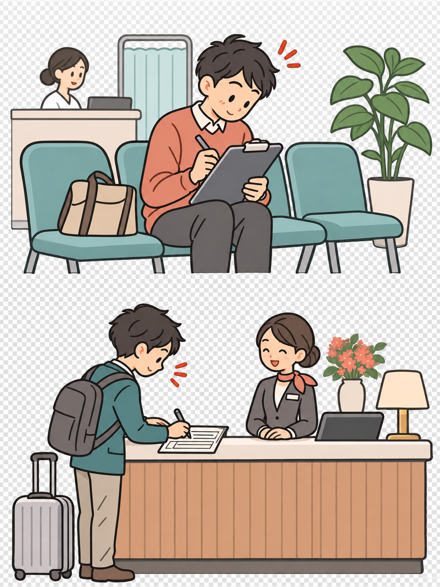

<!-- 病院で問診票を書いた時、マイナンバーカードで連携しているのに紙にも住所や生年月日を書く。ホテルも予約の時に情報を入れているのに、チェックインで住所を書く。落とし物があれば電話で連絡してもらえばいいんじゃないか、と思うんですよね。 -->

---

<!-- _class: media-split current-topic -->
<!-- _footer: 2. 使う人・作る人ができる情報の扱い > 作る側編 -->

<!-- フォームで必要のない情報まで必須にするのはタチが悪いと思います。任意にできるなら使う人に判断を委ねる。そもそも集めなくていい情報はないか、考えたいです。 -->

## 作る側の話: その情報は必須かどうかを考える

- 必要のない情報を必須にしない
- 任意にして、使う人に判断を委ねる
- そもそも、もらわなくていい情報はないか

---

<!-- _class: media-split current-topic -->
<!-- _footer: 2. 使う人・作る人ができる情報の扱い > 作る側編 -->

## フォームは、必要な項目だけにする

- 何十代か知りたい => 年代だけ
- どの地域か知りたい => 都道府県や市区町村まで
- 生年月日や住所全部は聞かない
- 持つ情報が減る => 守る情報も減る

<!-- マーケティングで何十代が多いか知りたいなら、生年月日ではなく年代だけでいい。どの地域の人が使っているか知りたいなら、都道府県や市区町村まででいい。生年月日や住所を全部もらう必要はないですよね。 -->

---

<!-- _class: media-split current-topic -->
<!-- _footer: 2. 使う人・作る人ができる情報の扱い > 作る側編 -->

## 保存する情報と期間を決めておく

- そもそも保存しない
- 病院の例：1年以上利用がなければ削除
- 便利だから、で残し続けない

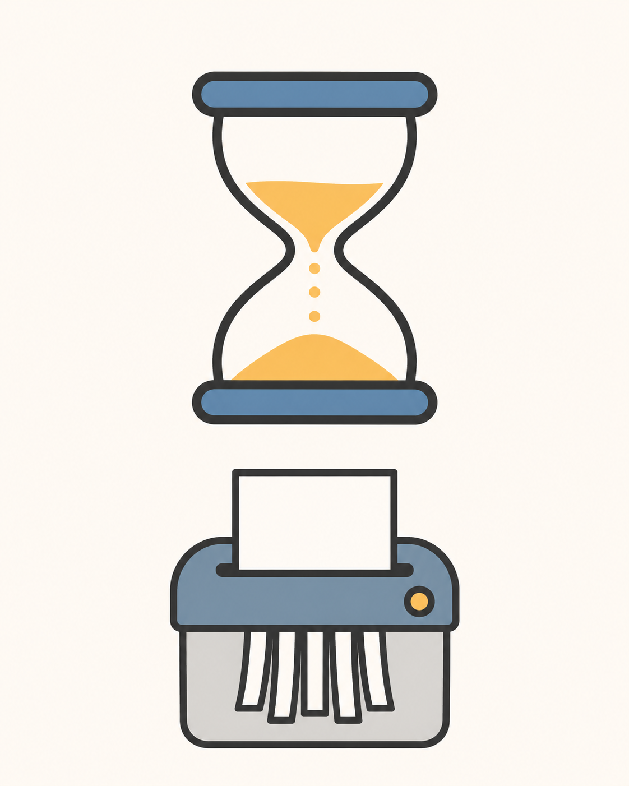

<!-- 集めないのが一番ですが、必要な情報を集めるなら、規約で説明して、いつ消すか決めておく。たとえば病院で1年以上利用がなければ消す、というやり方もありそうです。実際のルールは確認が必要ですが、ずっと残しておくと攻撃された時に漏れる情報も増えます。 -->

---

<!-- _class: current-topic -->
<!-- _footer: 2. 使う人・作る人ができる情報の扱い > 作る側編 -->

## 蛇足: 本人確認の情報は、伝え方も考えたい

- 僕の入院時の某病院例
  - 骨折の手術後、受付で名前と生年月日を口頭確認
  - 待合の人にも聞こえるかもしれない
  - 本人確認の必要性はあるが...

<!-- 僕は骨を折って日本大学で手術した時に、受付で毎回名前と生年月日を言わされました。横で聞いている人がいたら怖いですよね。その情報でできてしまうこともあるので、誰が必要なのか、どう伝えるのかを考えたいです。 -->

---

<!-- _footer: 3. 管理する人が整える、安全に試せる場 > 管理者編 -->

<!-- _class: source-cards current-topic stage -->

## 情報管理は、システムの外にも続く

<article class="gl-source"><strong class="t-body">紙の記録が621人分、所在不明に</strong>
静岡県立学校6校で生徒指導要録を紛失。外部流出は確認されていません。
<small class="t-note"><a href="https://look.satv.co.jp/content_news/incident/99223">静岡朝日テレビ / 2026年9月29日</a></small></article>
<article class="gl-source">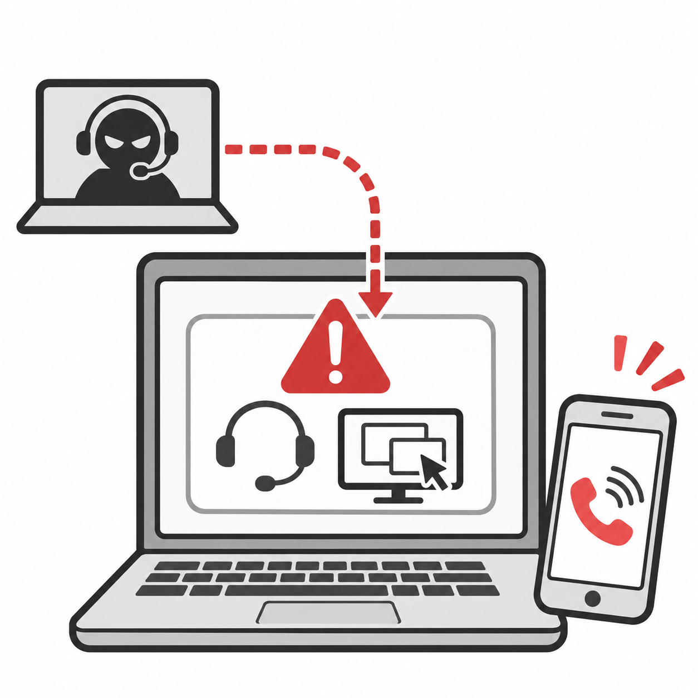<strong class="t-body">個人PCがサポート詐欺被害に</strong>
看護師の個人PCが遠隔操作され、保存されていた患者情報1,365件が漏えいした可能性。
<small class="t-note"><a href="https://internet.watch.impress.co.jp/docs/news/2114633.html">INTERNET Watch / 2026年6月5日</a></small></article>

<!-- 漏えいと一言でいっても、静岡県の事案では紙の記録が所在不明になり、外部流出は確認されていません。藤田医科大学病院の事案では、院内規程に反して患者情報を保存していた看護師の個人PCがサポート詐欺で遠隔操作され、情報が漏えいした可能性があります。情報を守る範囲は、病院のシステム内だけではありません。イラストは事案を説明するための生成画像で、実際の現場写真ではありません。出典: 静岡朝日テレビ https://look.satv.co.jp/content_news/incident/99223、INTERNET Watch https://internet.watch.impress.co.jp/docs/news/2114633.html -->

---

<!-- _class: current-topic -->
<!-- _footer: 3. 管理する人が整える、安全に試せる場 > 管理者編 -->

## 情報もサービスも日々、変わっていく

- AIサービスの契約や設定
- アプリの機能や公開方法
- 新しい脆弱性や事故事例
  - 2週間前は対応が重なって疲弊していた...

<!-- 新しい脆弱性やインシデントの話を追いかけないといけない。毎日のように出てきて、僕も2週間前は対応が重なってかなり疲弊しました。管理する側は情報を追う必要があります。 -->

---

<!-- _class: current-topic -->
<!-- _footer: 3. 管理する人が整える、安全に試せる場 > 管理者編 -->

## 管理する人は、安全に試せる場を作る

- 院内LANだけで使う業務アプリ
- 実データを使わない診断アプリ
- 本番システムや患者情報から分ける

<!-- 人を雇わない、何も触らせない、というのは現実的には難しい。人が関わるなら、リテラシーを上げる必要があります。本番データは使わず、病院の中だけで使うものや、内部情報を使わない診断アプリを安全な場所で作ってみる。 -->

---

<!-- _class: media-split current-topic -->
<!-- _footer: 3. 管理する人が整える、安全に試せる場 > 管理者編 -->

## 安全に試す経験が、情報を扱う力を育てる

- データがどこに行くか確かめる
- 誰が使えるか考える
- 失敗や工夫を共有する

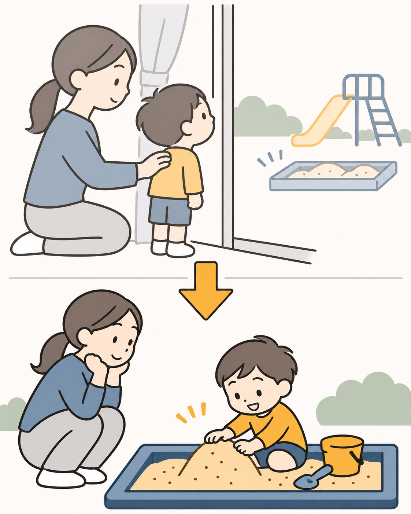

<!-- これは僕の感覚ですけど、ある程度サンドボックスで実際に作ってみるのが大事だと思っています。紙でも漏れるし、システムを固めるだけでは終わらない。作りながら学んでいくんですよね。 -->

---

<!-- _class: current-topic -->
<!-- _footer: 4. 作って試し、設計の工夫を発信する -->

## 公開する前提で、置く情報を選ぶ

- ビルの入口の鍵が開いていたら？
- 大事なものは部屋に置きっぱなしにしない
- 自分のWebサイト：ソースコード公開中
- 公開するコードに秘密や実データを置かない

<!-- 僕も今、自分のウェブサイトのソースコードを公開してみています。隠そうとすると、ソースコードを置く場所に要らないものを残してしまうことがある。貸会議室のビルの鍵が開いていたら、貴重品を置きっぱなしにしないですよね。必要なものだけ金庫に入れる、持ち帰る。公開前提で作るのも同じです。 -->

---

<!-- _class: media-split current-topic -->
<!-- _footer: 4. 作って試し、設計の工夫を発信する -->

## 作ったものと、設計の工夫を発信しよう

- 何を作り、何を試したか
- 集めない情報を決める
- 必要な期限が来たら消す
- データや権限を分ける

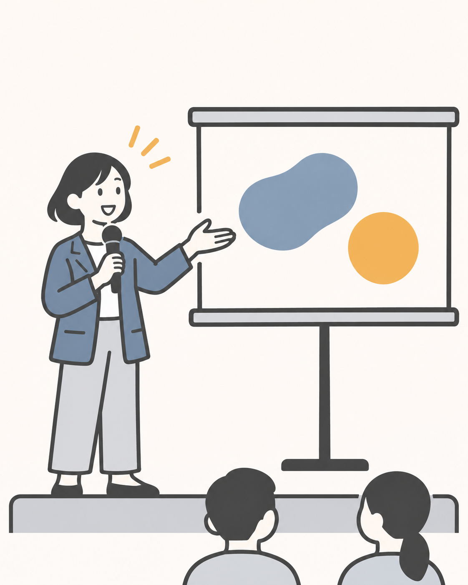

<!-- 作ったものを公開する時は、設計意図も一緒に話したいです。何を集めないか、いつ消すか、データや権限をどう分けたか。そういうところを発信すると、使う人も安心できるし、現場で作ることも応援してもらえると思います。 -->

---

<!-- _class: summary current-topic -->
<!-- _footer: 4. 作って試し、設計の工夫を発信する -->

## まとめ

- どんどん作れるようになってきた
- データは漏れる前提くらいで考えておく
  - 集めない（渡さない）
  - 保存しない
  - 保存場所と権限を分ける
- 各種意識
  - 作る側・使う側・管理者側、それぞれ考えましょう
- 教育大事
  - 自分で作って公開して学んで行こう => もいせんへ

---

<!-- _class: source-cards current-topic -->
<!-- _footer: 4. 作って試し、設計の工夫を発信する -->

## 番宣: もいせん・プロトアウトに来ましょう

<article class="gl-source">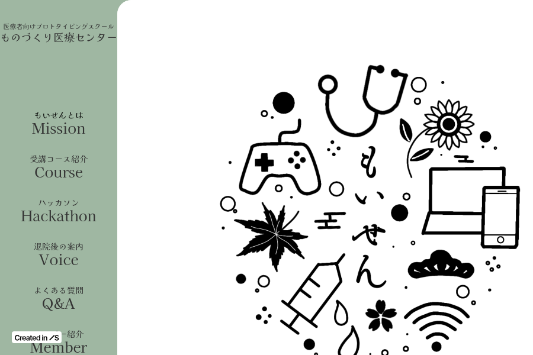<strong class="t-body">ものづくり医療センター「もいせん」</strong>
医療者が現場の課題を自分で解決するための学びの場。
<small class="t-note"><a href="https://moicen-forest.studio.site/">公式サイト</a></small></article>
<article class="gl-source">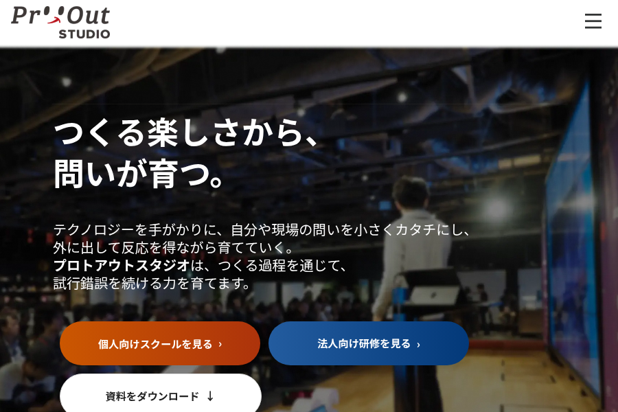<strong class="t-body">プロトアウトスタジオ</strong>
作って、外に出して、反応を得ながら学ぶ。
<small class="t-note"><a href="https://protoout.studio/">公式サイト</a></small></article>

学びながら、最新事例にも触れましょう。

<!-- もいせんとプロトアウトに来て、一緒に学びましょう。情報もサービスも変わるので、コミュニティに参加して最新事例にも触れていきましょう。 -->

---

<!-- _class: key-message current-topic -->
<!-- _footer: 4. 作って試し、設計の工夫を発信する -->

## アンケートはこちら

**［アンケートのQRコードをここに表示（後で差し替え）］**

<!-- 興味がある方はこちら。アンケートに回答してください。 -->

---

<!-- _class: link-cards current-topic -->
<!-- _footer: 4. 作って試し、設計の工夫を発信する -->

## 最新事例は「漏らされったー」で

<article class="gl-linkcard"><strong class="t-sub"><a href="https://morasaretter.suke.dev/">漏らされったー</a></strong><small class="t-note gl-muted">情報漏えいの事例を追いかける / <a href="https://morasaretter.suke.dev/">morasaretter.suke.dev</a></small></article>
