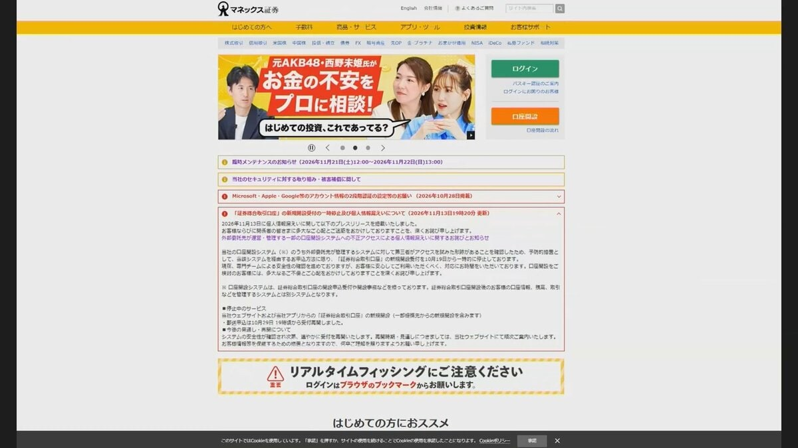

<!-- _class: title-slide -->

# 医療者もガンガン作ろう！ 作って試す時代の身の丈セキュリティ

第2回 ものづくり医療研究会

2026/11/15（日）13:45〜 ふれあい貸し会議室 秋葉原No53

菅原のびすけ @n0bisuke

---

<!-- _class: speaker-profile -->

## 菅原のびすけ

- プロトタイピングスクール「プロトアウトスタジオ」
- デジタルハリウッド大学大学院 非常勤講師
  - プロダクトプロトタイピング
- ソフトウェアエンジニア出身

個人活動

- IoTLT 主催
- Developers Summit 2025 ベストスピーカー 1位
- LINE API Expert / Microsoft MVP / IBM Champion

---

<!-- _class: current-topic -->
<!-- _footer: 1. 医療者が作れる時代と、現場で起きたこと -->

## 医療者がAIでアプリを作れる時代です

### AIで色々作れますね

- 受付・順番待ちシステム
- 問診フォーム
- 院内の業務改善アプリ

などなど

<!-- AIでアプリを作れるようになったのは、医療現場にとってすごくいいことだと思っています。現場を知っている人が、自分の困りごとをまず形にして試せる。これはもっと進めたいです。 -->

---

<!-- _class: source-cards current-topic -->
<!-- _footer: 1. 医療者が作れる時代と、現場で起きたこと -->

## 医療者は、現場の困りごとから作っている

<article class="gl-source"><strong class="t-body">院内LANで使う呼び出しシステム</strong>
産院の院長がChatGPTに相談しながら作成。投稿では実際の呼出し画面を紹介しています。
<small class="t-note"><a href="https://x.com/A_Mochizuki/status/2111079943400808872">産院のいんちょ / X / 2026年10月16日</a></small></article>
<article class="gl-source"><strong class="t-body">外来の前・中・後を助ける3つのツール</strong>
もいせん受講生の整形外科医が、LINE問診・カルテ音声入力・LINEセルフケア案内を制作。
<small class="t-note"><a href="https://note.com/dr_grid/n/nb44daadafdbf">Drグリッド / note / 2026年7月8日</a></small></article>

<!-- 現場の困りごとを起点に、医療者が自分で作った事例です。後者は受講生本人の振り返り記事で、外来の前・中・後に使う3つのツールを紹介しています。記事で確認できるのは本人による制作物の紹介で、効果の独立した検証ではありません。出典: 産院のいんちょ https://x.com/A_Mochizuki/status/2111079943400808872、Drグリッド https://note.com/dr_grid/n/nb44daadafdbf -->

---

<!-- _class: link-cards current-topic -->
<!-- _footer: 1. 医療者が作れる時代と、現場で起きたこと -->

## サイバー攻撃や情報漏えいが続き、世の中も敏感に

<!-- card: https://www.watch.impress.co.jp/docs/news/2144279.html -->
<article class="gl-linkcard" data-card="https://www.watch.impress.co.jp/docs/news/2144279.html"><strong class="t-sub"><a href="https://www.watch.impress.co.jp/docs/news/2144279.html">タイムズカーの情報漏洩、免許証など本人確認書類流出は160万件</a></strong><small class="t-note gl-muted">Impress Watch / 2026-09-29</small></article>
<!-- card: https://newsdig.tbs.co.jp/articles/-/3086013 -->
<article class="gl-linkcard" data-card="https://newsdig.tbs.co.jp/articles/-/3086013"><strong class="t-sub"><a href="https://newsdig.tbs.co.jp/articles/-/3086013">マネックス証券で不正アクセス被害　本人確認の画像データ1592件漏えいの可能性 | TBS NEWS DIG</a></strong><small class="t-note gl-muted">TBS NEWS DIG</small></article>

<!-- 最近もタイムズカーやマネックス証券などで情報漏えいの報道があり、サイバー攻撃や情報管理への関心が高まっています。そうした状況だからこそ、医療者が作ったものにも不安や厳しい声が向けられます。一方で、作られた背景まで見ると、単純に「作るべきではない」とは言えない事例もあります。こうした不安やヤジが出るのも、情報漏えいへの警戒が強まっているためです。出典: Impress Watch https://www.watch.impress.co.jp/docs/news/2144279.html、パーク２４ https://www.park24.co.jp/news/2026/10/20261023-1.html、TBS NEWS DIG https://newsdig.tbs.co.jp/articles/-/3086013、マネックス証券 https://prtimes.jp/main/html/rd/p/000000595.000005159.html -->

---

## 作る人へのヤジも、情報漏えいへの不安もある

<!-- _class: text-image current-topic -->
<!-- _footer: 1. 医療者が作れる時代と、現場で起きたこと -->

<!-- 作る人に向けた批判も、患者さんの情報が漏れることへの不安もあります。不安を無視せず、どうすれば安全に試せるかを考えます。出典: 発表者提供のX返信スクリーンショット（2026年10月18日）。 -->

---

## 背景を知らないまま、ヤジが飛んでくることもある

<!-- _class: text-image current-topic -->
<!-- _footer: 1. 医療者が作れる時代と、現場で起きたこと -->

<!-- セキュリティ上の確認は大切です。一方で、作った事情を知らないまま強い言葉だけが届くと、作る人にはつらいものです。だからといって不安を退けず、何を前提に作り、どこまで試したかを説明できるようにしたいです。出典: 発表者提供のXスクリーンショット（2026年10月18日）。 -->

---

## 作った背景には、現場の事情がある

<!-- _class: text-image current-topic -->
<!-- _footer: 1. 医療者が作れる時代と、現場で起きたこと -->

<!-- サイバー攻撃や情報漏えいへの不安が高まる中で、実際に院内システムが止まったため、呼び出しシステムを自作した事例を見ます。本人は、既存サービスへの不正アクセスで院内システムが止まり、呼び出しシステムが使えなくなったと説明しています。作る側の事情も知った上で、セキュリティを考えたいです。出典: 発表者提供のXスクリーンショット（2026年10月17日）。 -->

---

<!-- _class: key-message current-topic -->
<!-- _footer: 1. 医療者が作れる時代と、現場で起きたこと -->

## 今日のメッセージ

- セキュリティを意識して、もっと作って試そう。
- 作ったものと、**設計の工夫を発信しよう。**

<!-- セキュリティが心配だから作らない、ではなく、気をつける点を設計しながら作って試す。作ったものだけでなく、何を考えてどう試したかも共有できると、利用者の不安や指摘に設計意図をもって答えられます。 -->

---

<!-- _class: agenda overview -->

## 今日の流れ

1. 医療者が作れる時代と、現場で起きたこと
2. 使う人・作る人ができる情報の扱い
3. 管理する人が整える、安全に試せる場
4. 作って試し、設計の工夫を発信する

<!-- まず、医療者が自分で作れるようになったことと、実際に作った現場の背景を見ます。その上で、使う側、作る側、管理する側にできることを順に考え、最後に作って試したことや設計の工夫を発信する話につなげます。 -->

---

<!-- _class: current-topic -->
<!-- _footer: 2. 使う人・作る人ができる情報の扱い -->

## 作る人を中心に、3つの立場で考える

- 使う人 => 渡す情報を選ぶ
- 作る人 => 集める情報と保存先を考える
- 管理する人 => 安全に試せる場を作る

<!-- 作る人向けの話が中心ですが、話す順は利用者、作る人、管理者です。使う側として情報を渡す時の視点を確認してから、作る時の設計、管理する側の環境づくりへ進みます。 -->

---

<!-- _class: current-topic -->
<!-- _footer: 2. 使う人・作る人ができる情報の扱い -->

## 使う側: 必要以上に情報を渡さない

- 必要以上に情報を登録しない
  - 任意の項目は、必要なければ埋めない
- メール：エイリアス / 電話：IP電話
- 住所とかも正直に書く必要はあるか？

<!-- まずは使う側として、渡す情報を選びます。メールにはエイリアス、電話にはIP電話など、元の連絡先を直接渡さない方法が使えることがあります。問診票やホテルのチェックインで、予約や別の手続きですでに渡した情報をもう一度求められた時は、何に必要なのかを確かめます。必要な本人確認を妨げたり、不正確な情報を書いたりするのではなく、入力を求める理由を確認する姿勢です。 -->

---

<!-- _class: current-topic -->
<!-- _footer: 2. 使う人・作る人ができる情報の扱い -->

<!-- メールエイリアスを使うと、登録先ごとに別のメールアドレスを使いながら、受信は自分のメールにまとめられます。 -->

---

<!-- _class: current-topic -->
<!-- _footer: 2. 使う人・作る人ができる情報の扱い -->

<!-- Aで使った専用アドレスが漏れても、B/C用のアドレスや本来のメールとは分かれているので、他への影響を抑えやすくなります。パスワードの使い回しなど、別の情報まで保護するものではありません。 -->

---

<!-- _class: current-topic -->
<!-- _footer: 2. 使う人・作る人ができる情報の扱い -->

## 情報、もう一度聞かれていませんか？

- 病院の問診票：マイナ連携後も住所・生年月日
- ホテル受付：予約済みなのに、住所を再記入
- 「本当に必要？」と立ち止まる

<!-- 病院の問診票で、マイナンバーカードで連携した後なのに、紙にも生年月日や住所を書くことがあります。ホテルでも予約時に情報を入れているのに、チェックインで住所を聞かれることがあります。僕は「本当に必要か？」と考え、必要ないと思う住所は適当に書くこともあります。余計な情報を渡さない、という話です。 -->

---

<!-- _class: current-topic -->
<!-- _footer: 2. 使う人・作る人ができる情報の扱い -->

## AIが作ったフォームを、そのまま使わない

- その情報は何のため？
- 必須にする理由はある？
- 保存する必要はある？

<!-- AIにフォームを作らせると、よくある入力欄が一式ついてくることがあります。名前や生年月日を入れる前に、何に使うのか、必須なのか、保存するのかを考えます。 -->

---

<!-- _class: current-topic -->
<!-- _footer: 2. 使う人・作る人ができる情報の扱い -->

## フォームは、必要な項目だけにする

- 年代だけ知りたい => 生年月日を聞かない
- 地域だけ知りたい => 住所全部を聞かない
- 持つ情報が減る => 守る情報も減る

<!-- 何十代の人が多いか知りたいだけなら、生年月日ではなく年代で足ります。地域の傾向を見たいだけなら、番地までの住所は要りません。目的に合わせて必要な粒度だけ聞けば、入力の負担も、作った側が守る情報も減らせます。 -->

---

<!-- _class: current-topic -->
<!-- _footer: 2. 使う人・作る人ができる情報の扱い -->

## 保存する情報と期間を決めておく

- そもそも保存しない
- 病院の例：1年以上利用がなければ削除
- 便利だから、で残し続けない

<!-- データは、集めた時点だけでなく保存中も守らなければいけません。使う目的が終わったら削除できるか、最初に考えておくと運用も楽になります。タイムズカーの事例も、情報を持つ期間を見直すきっかけとして紹介しました。 -->

---

<!-- _class: current-topic -->
<!-- _footer: 2. 使う人・作る人ができる情報の扱い -->

## 本人確認の情報は、伝え方も考えたい

- 骨折の手術後、受付で名前と生年月日を口頭確認
- 待合の人にも聞こえるかもしれない
- 本人確認の必要性と伝え方を考える

<!-- 僕自身、骨折の手術後に受付で毎回名前と生年月日を口頭で伝えていました。本人確認が必要なのは分かりますが、待合にいる人にも聞こえるのではと不安に感じました。誰がどの情報を知る必要があるかだけでなく、どう伝わるかも考えたいです。 -->

---

<!-- _class: current-topic -->
<!-- _footer: 3. 管理する人が整える、安全に試せる場 -->

## 情報は、システムの外でも漏れる

- 教員：紙の書類を紛失
- 看護師：偽のWindows警告からサポート詐欺
- システムの外でも情報は漏れる

<!-- 漏えいのきっかけは、システムの外にもあります。紙をなくすこともあれば、偽の警告画面から電話をかけさせ、操作を誘導するサポート詐欺もあります。システム対策だけでなく、使う人が状況を理解して判断できることも必要です。 -->

---

<!-- _class: current-topic -->
<!-- _footer: 3. 管理する人が整える、安全に試せる場 -->

## 情報もサービスも、変わっていく

- AIサービスの契約や設定
- アプリの機能や公開方法
- 新しい脆弱性や事故事例
- 2週間前：対応が重なって疲弊

<!-- 脆弱性やインシデントへの対応は、管理する人が追い続ける必要があります。僕もこの2週間ほど、複数の対応に追われて疲弊しました。一方で、システムを更新し続けても、人が詐欺にあったり、紙をなくしたりする可能性は残ります。だから技術の更新と、人が学ぶ機会の両方が必要です。 -->

---

<!-- _class: current-topic -->
<!-- _footer: 3. 管理する人が整える、安全に試せる場 -->

## 管理する人は、安全に試せる場を作る

- 院内LANだけで使う業務アプリ
- 実データを使わない診断アプリ
- 本番システムや患者情報から分ける

<!-- アクセスを厳しく制限すれば、できることもなくなってしまいます。人が関わる以上、教育が必要です。管理する人は、禁止だけでなく、ダミーデータを使い、本番システムや患者情報と切り離したサンドボックスを用意します。試作をそのまま実運用に移さず、実運用に進む時は組織のルールや管理方法を改めて確認します。 -->

---

<!-- _class: current-topic -->
<!-- _footer: 3. 管理する人が整える、安全に試せる場 -->

## 作る人は、まずダミーデータで試す

- 氏名 => 患者A
- 生年月日 => 仮の日付
- 問診内容 => テスト用の例

<!-- 作る人は、最初から実際の患者さんのデータを使わないで、ダミーデータで画面や処理を試せます。実際の情報が必要になる段階が来たら、目的や扱いを確認してから進みます。 -->

---

<!-- _class: current-topic -->
<!-- _footer: 3. 管理する人が整える、安全に試せる場 -->

## 安全に試す経験が、情報を扱う力を育てる

- データがどこに行くか確かめる
- 誰が使えるか考える
- 失敗や工夫を共有する

<!-- これは僕の感覚ですが、ある程度安全な環境で実際にシステムを作ってみることが大切です。紙でも情報は漏れます。作る経験を通じて、データがどこに行くか、誰が使えるかを具体的に考え、情報を扱う力を身につけていきます。 -->

---

<!-- _class: current-topic -->
<!-- _footer: 4. 作って試し、設計の工夫を発信する -->

## 公開する前提で、置く情報を選ぶ

- ビルの入口の鍵が開いていたら？
- 大事なものは部屋に置きっぱなしにしない
- 自分のWebサイト：ソースコード公開中
- 公開するコードに秘密や実データを置かない

<!-- 貸会議室の入口の鍵が開いているなら、部屋に貴重品を置きっぱなしにしないですよね。必要なものだけ金庫に入れる、使わないものは持ち込まない。公開する前提で作る経験も同じで、コードに秘密情報や患者さんの実データを置かない設計を考えるきっかけになります。公開すれば安全という話ではありません。 -->

---

<!-- _class: current-topic -->
<!-- _footer: 4. 作って試し、設計の工夫を発信する -->

## 作ったものと、設計の工夫を発信しよう

- 何を作り、何を試したか
- どんな情報を集めないと決めたか
- どこまで確認できたか

<!-- 動くものだけでなく、何を集めないと決めたか、どこまで試して何が未確認かも発信すると、使う人に設計意図を伝えられます。僕も自分のWebサイトをAIと作る中で、ソースコードを公開する前提で進めています。公開すれば安全という意味ではありませんが、公開するものと秘密にする情報を分ける設計を考えるきっかけになります。 -->

---

<!-- _class: current-topic -->
<!-- _footer: 4. 作って試し、設計の工夫を発信する -->

## アンケートも、必要な情報だけを聞く

- 最初のフォームには、生年月日欄があった
- 最終版は、回答に必要な項目に絞った

<!-- 最後に案内するアンケートも、回答に必要のない個人情報は集めない形にしました。最初のフォームに生年月日欄があり、使いにくいと自分で気づいた経験も含めて、作ったものを試し、設計を見直す例として話します。 -->

---

<!-- _class: key-message stage current-topic -->
<!-- _footer: 4. 作って試し、設計の工夫を発信する -->

## 今日のメッセージ（再掲）

**セキュリティを意識して、もっと作って試そう。**

**作ったものと、設計の工夫を発信しよう。**

---

<!-- _class: closing current-topic -->
<!-- _footer: 4. 作って試し、設計の工夫を発信する -->

## セキュリティを意識して、もっと作って試そう。

**作ったものと、設計の工夫を発信しよう。**
