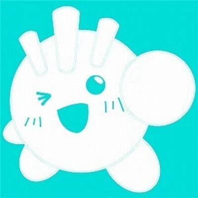
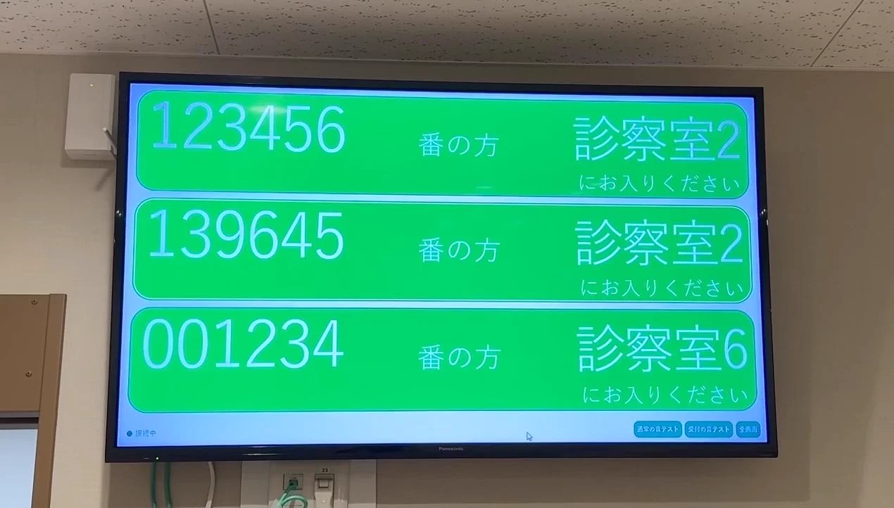
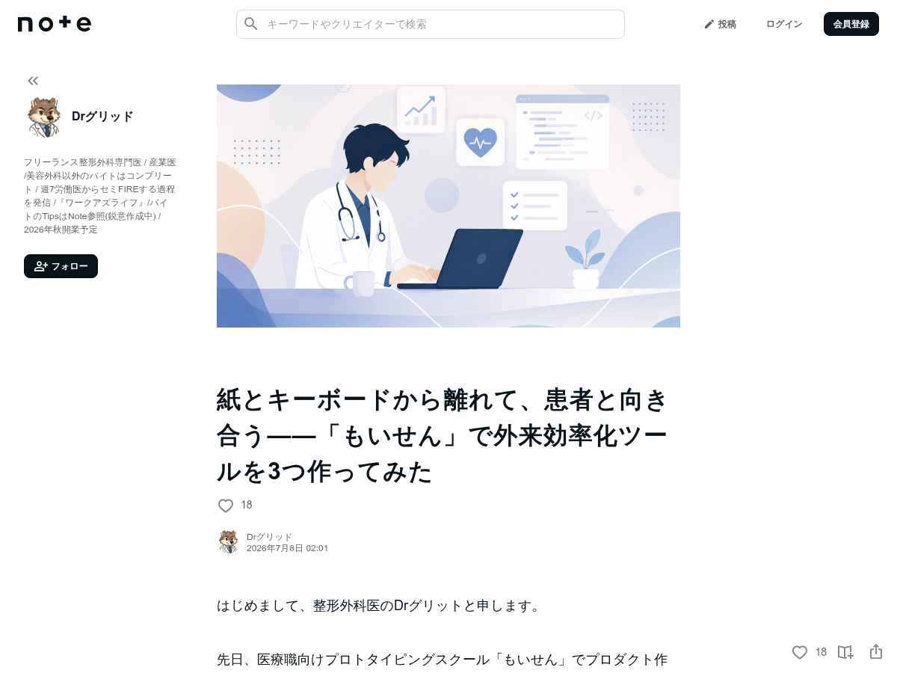
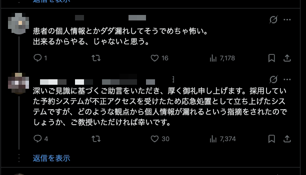
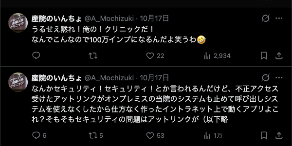

<!-- _class: title-slide -->

# 医療者もガンガン作ろう！ 作って試す時代の身の丈セキュリティ

第2回 ものづくり医療研究会

2026/11/15（日）13:45〜 ふれあい貸し会議室 秋葉原No53

菅原のびすけ @n0bisuke

---

<!-- _class: speaker-profile -->

## 菅原のびすけ

- プロトタイピングスクール「プロトアウトスタジオ」
- デジタルハリウッド大学大学院 非常勤講師
  - プロダクトプロトタイピング
- ソフトウェアエンジニア出身

個人活動

- IoTLT 主催
- Developers Summit 2025 ベストスピーカー 1位
- LINE API Expert / Microsoft MVP / IBM Champion

---

## 医療者がAIでアプリを作れる時代です

### AIで色々作れますね

- 受付・順番待ちシステム
- 問診フォーム
- 院内の業務改善アプリ

などなど

<!-- AIでアプリを作れるようになったのは、医療現場にとってすごくいいことだと思っています。現場を知っている人が、自分の困りごとをまず形にして試せる。これはもっと進めたいです。 -->

---

<!-- _class: source-cards -->

## 医療者は、現場の困りごとから作っている

<article class="gl-source"><strong class="t-body">院内LANで使う呼び出しシステム</strong>
産院の院長がChatGPTに相談しながら作成。投稿では実際の呼出し画面を紹介しています。
<small class="t-note"><a href="https://x.com/A_Mochizuki/status/2111079943400808872">産院のいんちょ / X / 2026年10月16日</a></small></article>
<article class="gl-source"><strong class="t-body">外来の前・中・後を助ける3つのツール</strong>
もいせん受講生の整形外科医が、LINE問診・カルテ音声入力・LINEセルフケア案内を制作。
<small class="t-note"><a href="https://note.com/dr_grid/n/nb44daadafdbf">Drグリッド / note / 2026年7月8日</a></small></article>

<!-- 現場の困りごとを起点に、医療者が自分で作った事例です。後者は受講生本人の振り返り記事で、外来の前・中・後に使う3つのツールを紹介しています。記事で確認できるのは本人による制作物の紹介で、効果の独立した検証ではありません。出典: 産院のいんちょ https://x.com/A_Mochizuki/status/2111079943400808872、Drグリッド https://note.com/dr_grid/n/nb44daadafdbf -->

---

## 作る人へのヤジも、情報漏えいへの不安もある

<!-- 作る人に向けた批判も、患者さんの情報が漏れることへの不安もあります。不安を無視せず、どうすれば安全に試せるかを考えます。出典: 発表者提供のX返信スクリーンショット（2026年10月18日）。 -->

---

## 作った背景には、現場の事情がある

<!-- 本人は、既存サービスへの不正アクセスで院内システムが止まり、呼び出しシステムが使えなくなったため、やむを得ず作ったと説明しています。作ったものだけを見ると、こうした背景は伝わりません。出典: 発表者提供のXスクリーンショット（2026年10月17日）。 -->

---

## 背景を知らないまま、ヤジが飛んでくることもある

<!-- セキュリティ上の確認は大切です。一方で、作った事情を知らないまま強い言葉だけが届くと、作る人にはつらいものです。だからといって不安を退けず、何を前提に作り、どこまで試したかを説明できるようにしたいです。出典: 発表者提供のXスクリーンショット（2026年10月18日）。 -->

---

<!-- _class: link-cards -->

## 本人確認書類の画像も、流出するおそれがある

<!-- card: https://www.watch.impress.co.jp/docs/news/2144279.html -->
<article class="gl-linkcard" data-card="https://www.watch.impress.co.jp/docs/news/2144279.html"><strong class="t-sub"><a href="https://www.watch.impress.co.jp/docs/news/2144279.html">タイムズカーの情報漏洩、免許証など本人確認書類流出は160万件</a></strong><small class="t-note gl-muted">Impress Watch / 2026-09-29</small></article>
<!-- card: https://newsdig.tbs.co.jp/articles/-/3086013 -->
<article class="gl-linkcard" data-card="https://newsdig.tbs.co.jp/articles/-/3086013"><strong class="t-sub"><a href="https://newsdig.tbs.co.jp/articles/-/3086013">マネックス証券で不正アクセス被害　本人確認の画像データ1592件漏えいの可能性</a></strong><small class="t-note gl-muted">TBS NEWS DIG / 2026-11-14</small></article>

<!-- タイムズカーでは本人確認書類画像を含む情報が流出した可能性があり、会社は登録完了後に画像を保有しないルールに変更しました。マネックス証券では、外部委託先が運営する口座開設システムから、本人確認書類画像1,592件とメールアドレス最大113万件が流出したおそれがあります。画像には運転免許証の表裏、マイナンバーカードの表面、自撮りが含まれますが、個人番号そのものやカード裏面の漏えいは確認されていません。どちらの事例も、集める情報を絞ること、保有期間を決めること、委託先のシステムも含めて管理することを考える材料になります。出典: Impress Watch https://www.watch.impress.co.jp/docs/news/2144279.html、パーク２４ https://www.park24.co.jp/news/2026/10/20261023-1.html、TBS NEWS DIG https://newsdig.tbs.co.jp/articles/-/3086013、マネックス証券 https://prtimes.jp/main/html/rd/p/000000595.000005159.html -->

---

<!-- _class: key-message -->

## セキュリティを意識して、もっと作って試そう。

**作ったものと、設計の工夫を発信しよう。**

<!-- セキュリティが心配だから作らない、ではなく、気をつける点を設計しながら作って試す。作ったものだけでなく、何を考えてどう試したかも共有できると、利用者の不安や指摘に設計意図をもって答えられます。 -->

---

## 作る人を中心に、3つの立場で考える

- 使う人 => 渡す情報を選ぶ
- 作る人 => 集める情報と保存先を考える
- 管理する人 => 安全に試せる場を作る

<!-- 作る人向けの話が中心ですが、まずは使う人として、必要以上の情報を渡さない視点から始めます。その後、作る人がデータの扱いを設計し、管理する人が安全に試せる場を考えます。 -->

---

## 使うときは、必要以上に情報を渡さない

- AIやサービスに患者さんの実データを入れない
- 任意の項目は、必要なければ埋めない
- メールや電話番号は、用途を分けられるか考える

<!-- 利用者としては、入力する情報を一度立ち止まって見ます。試作中のAIに患者さんの実データを入れず、ダミーデータにする。任意項目は必要がなければ入力しない。メールはエイリアス、電話は用途別の番号やIP電話などを使える場合があります。問診票やホテルのチェックインで、予約や他の手続きで渡した情報をもう一度求められた時は、何に必要なのか確認します。必須項目に不正確な情報を書くのではなく、必要性を確かめます。 -->

---

<!-- メールエイリアスを使うと、登録先ごとに別のメールアドレスを使いながら、受信は自分のメールにまとめられます。 -->

---

<!-- Aで使った専用アドレスが漏れても、B/C用のアドレスや本来のメールとは分かれているので、他への影響を抑えやすくなります。パスワードの使い回しなど、別の情報まで保護するものではありません。 -->

---

## 作る人は、まずダミーデータで試す

- 氏名 => 患者A
- 生年月日 => 仮の日付
- 問診内容 => テスト用の例

<!-- 作る人は、最初から実際の患者さんのデータを使わないで、ダミーデータで画面や処理を試せます。実際の情報が必要になる段階が来たら、目的や扱いを確認してから進みます。 -->

---

## AIが作ったフォームを、そのまま使わない

- その情報は何のため？
- 必須にする理由はある？
- 保存する必要はある？

<!-- AIにフォームを作らせると、よくある入力欄が一式ついてくることがあります。名前や生年月日を入れる前に、何に使うのか、必須なのか、保存するのかを考えます。 -->

---

## フォームは、必要な項目だけにする

- 年代だけ知りたい => 生年月日を聞かない
- 地域だけ知りたい => 住所全部を聞かない
- 持つ情報が減る => 守る情報も減る

<!-- 何十代の人が多いか知りたいだけなら、生年月日ではなく年代で足ります。地域の傾向を見たいだけなら、番地までの住所は要りません。目的に合わせて必要な粒度だけ聞けば、入力の負担も、作った側が守る情報も減らせます。 -->

---

## 保存する情報と期間を決めておく

- そもそも保存しない
- 必要な期間が過ぎたら消す
- 便利だから、で残し続けない

<!-- データは、集めた時点だけでなく保存中も守らなければいけません。使う目的が終わったら削除できるか、最初に考えておくと運用も楽になります。タイムズカーの事例も、情報を持つ期間を見直すきっかけとして紹介しました。 -->

---

## 本人確認の情報は、伝え方も考えたい

- 骨折の手術後、受付で名前と生年月日を口頭確認
- 待合の人にも聞こえるかもしれない
- 本人確認の必要性と伝え方を考える

<!-- 僕自身、骨折の手術後に受付で毎回名前と生年月日を口頭で伝えていました。本人確認が必要なのは分かりますが、待合にいる人にも聞こえるのではと不安に感じました。誰がどの情報を知る必要があるかだけでなく、どう伝わるかも考えたいです。 -->

---

## 管理する人は、安全に試せる場を作る

- 試作にはダミーデータを使う
- まずは公開範囲を絞る
- 本番システムや患者情報から分ける

<!-- 管理する人には、禁止だけでなく試作できる環境を用意する役割があります。まずダミーデータで、公開範囲を絞り、本番システムや患者情報から切り離して試す。試作をそのまま実運用に移さず、実運用に進む時は組織のルールや管理方法を改めて確認します。 -->

---

## 情報は、システムの外でも漏れる

- 紙をなくす、置き忘れる
- 受付で名前や生年月日を声に出す
- 人が詐欺の指示に従ってしまう

<!-- 漏えいの原因はアプリだけではありません。紙をなくすことも、人が詐欺の指示に従ってしまうこともあります。僕自身、骨折の治療で通院していた時、受付で名前と生年月日を毎回口頭で伝えていました。本人確認が必要な場面でも、待合の人に聞こえる形で伝えることには不安を感じました。紙かデジタルかだけで考えず、情報をどう扱い、誰に見せるかを考える必要があります。 -->

---

## 安全に試す経験が、情報を扱う力を育てる

- データがどこに行くか確かめる
- 誰が使えるか考える
- 失敗や工夫を共有する

<!-- これは僕の感覚ですが、ある程度安全な環境で実際にシステムを作ってみることが大切です。紙でも情報は漏れます。作る経験を通じて、データがどこに行くか、誰が使えるかを具体的に考え、情報を扱う力を身につけていきます。 -->

---

## 公開する前提で、置く情報を選ぶ

- ビルの入口の鍵が開いていたら？
- 大事なものは部屋に置きっぱなしにしない
- 公開するコードに秘密や実データを置かない

<!-- 貸会議室の入口の鍵が開いているなら、部屋に貴重品を置きっぱなしにしないですよね。必要なものだけ金庫に入れる、使わないものは持ち込まない。公開する前提で作る経験も同じで、コードに秘密情報や患者さんの実データを置かない設計を考えるきっかけになります。公開すれば安全という話ではありません。 -->

---

## 情報もサービスも、変わっていく

- AIサービスの契約や設定
- アプリの機能や公開方法
- 新しい脆弱性や事故事例

<!-- 今日話したことも、AIサービスやアプリの仕組みが変われば見直しが必要です。一度覚えたルールだけで終わらせず、使っているサービスや公開方法が変わっていないか確かめます。 -->

---

## 作ったものと、設計の工夫を発信しよう

- 何を作り、何を試したか
- どんな情報を集めないと決めたか
- どこまで確認できたか

<!-- 動くものだけでなく、何を集めないと決めたか、どこまで試して何が未確認かも発信すると、使う人に設計意図を伝えられます。僕も自分のWebサイトをAIと作る中で、ソースコードを公開する前提で進めています。公開すれば安全という意味ではありませんが、公開するものと秘密にする情報を分ける設計を考えるきっかけになります。 -->

---

<!-- _class: key-message stage -->

## 今日のメッセージ（再掲）

**セキュリティを意識して、もっと作って試そう。**

**作ったものと、設計の工夫を発信しよう。**

---

<!-- _class: closing -->

## セキュリティを意識して、もっと作って試そう。

**作ったものと、設計の工夫を発信しよう。**
