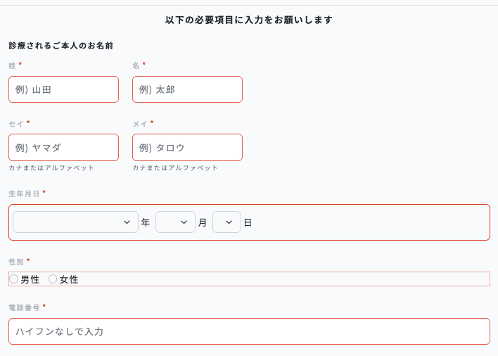
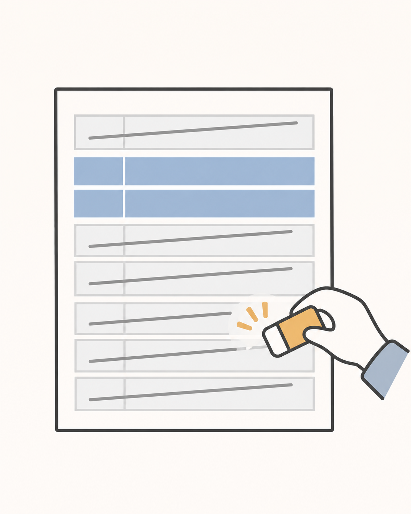
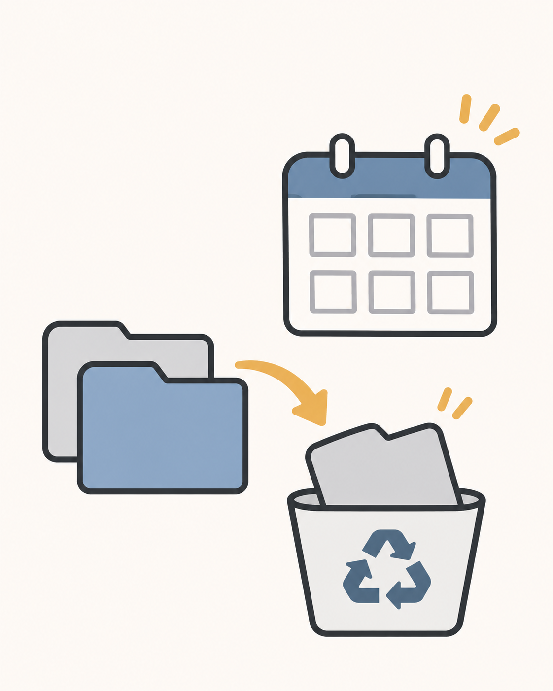
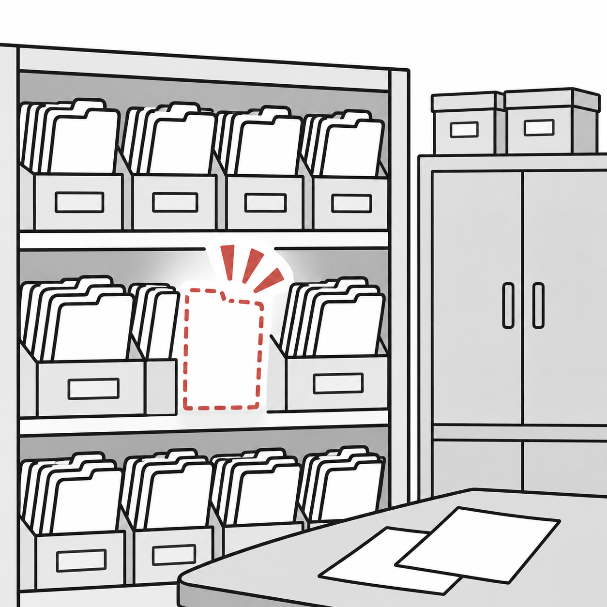
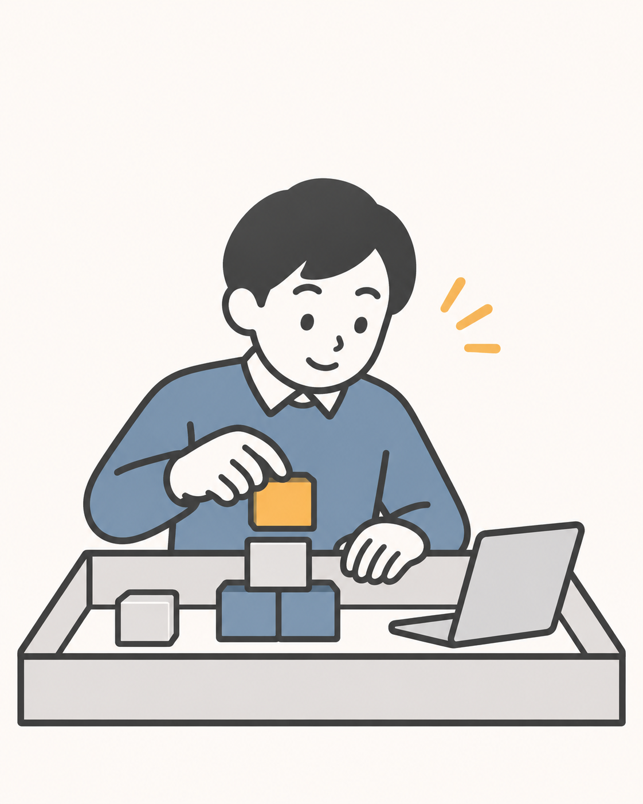

<!-- _class: title-slide -->

# 医療者もガンガン作ろう！ 作って試す時代の身の丈セキュリティ

第2回 ものづくり医療研究会

2026/11/15（日）13:45〜 ふれあい貸し会議室 秋葉原No53

菅原のびすけ @n0bisuke

---

<!-- _class: speaker-profile -->

## 菅原のびすけ

- プロトタイピングスクール「プロトアウトスタジオ」
- デジタルハリウッド大学大学院 非常勤講師
  - プロダクトプロトタイピング
- ソフトウェアエンジニア出身

個人活動

- IoTLT 主催
- Developers Summit 2025 ベストスピーカー 1位
- LINE API Expert / Microsoft MVP / IBM Champion

---

<!-- _class: source-cards current-topic -->
<!-- _footer: 1. 医療者が作れる時代と、現場で起きたこと -->

## 医療者は、現場の困りごとから作っている

<article class="gl-source"><strong class="t-body">院内LANで使う呼び出しシステム</strong>
産院の院長がChatGPTに相談しながら作成。投稿では実際の呼出し画面を紹介しています。
<small class="t-note"><a href="https://x.com/A_Mochizuki/status/2111079943400808872">産院のいんちょ / X / 2026年10月16日</a></small></article>
<article class="gl-source"><strong class="t-body">外来の前・中・後を助ける3つのツール</strong>
もいせん受講生の整形外科医が、LINE問診・カルテ音声入力・LINEセルフケア案内を制作。
<small class="t-note"><a href="https://note.com/dr_grid/n/nb44daadafdbf">Drグリッド / note / 2026年7月8日</a></small></article>

<!-- 医セン界隈でも、自分で作る人が出てきています。産院の先生が受付・順番待ちのシステムを作った例や、もいせん受講生が外来で使うツールを作った例があります。 -->

---

<!-- _class: key-message current-topic -->
<!-- _footer: 1. 医療者が作れる時代と、現場で起きたこと -->

## 今日のメッセージ

- セキュリティを意識して、もっと作って試そう。
- 作ったものと、**設計の工夫を発信しよう。**

<!-- 作るのを止める話ではなくて、セキュリティを意識して作って試す。その上で、作ったものだけじゃなく、どういう設計にしたかも話していきたいです。 -->

---

<!-- _class: media-split current-topic -->
<!-- _footer: 2. 使う人・作る人ができる情報の扱い > 作る側編 -->

<!-- フォームで必要のない情報まで必須にするのはタチが悪いと思います。任意にできるなら使う人に判断を委ねる。そもそも集めなくていい情報はないか、考えたいです。 -->

## 作る側の話: その情報は必須かどうかを考える

- 必要のない情報を必須にしない
- 任意にして、使う人に判断を委ねる
- そもそも、もらわなくていい情報はないか

---

<!-- _class: media-split current-topic -->
<!-- _footer: 2. 使う人・作る人ができる情報の扱い > 作る側編 -->

## フォームは、必要な項目だけにする

- 何十代か知りたい => 年代だけ
- どの地域か知りたい => 都道府県や市区町村まで
- 生年月日や住所全部は聞かない
- 持つ情報が減る => 守る情報も減る

<!-- マーケティングで何十代が多いか知りたいなら、生年月日ではなく年代だけでいい。どの地域の人が使っているか知りたいなら、都道府県や市区町村まででいい。生年月日や住所を全部もらう必要はないですよね。 -->

---

<!-- _class: media-split current-topic -->
<!-- _footer: 2. 使う人・作る人ができる情報の扱い > 作る側編 -->

## 保存する情報と期間を決めておく

- そもそも保存しない
- 病院の例：1年以上利用がなければ削除
- 便利だから、で残し続けない

<!-- 集めないのが一番ですが、必要な情報を集めるなら、規約で説明して、いつ消すか決めておく。たとえば病院で1年以上利用がなければ消す、というやり方もありそうです。実際のルールは確認が必要ですが、ずっと残しておくと攻撃された時に漏れる情報も増えます。 -->

---

<!-- _footer: 3. 管理する人が整える、安全に試せる場 > 管理者編 -->

<!-- _class: source-cards current-topic stage -->

## 情報管理は、システムの外にも続く

<article class="gl-source"><strong class="t-body">紙の記録が621人分、所在不明に</strong>
静岡県立学校6校で生徒指導要録を紛失。外部流出は確認されていません。
<small class="t-note"><a href="https://look.satv.co.jp/content_news/incident/99223">静岡朝日テレビ / 2026年9月29日</a></small></article>
<article class="gl-source"><strong class="t-body">個人PCがサポート詐欺被害に</strong>
看護師の個人PCが遠隔操作され、保存されていた患者情報1,365件が漏えいした可能性。
<small class="t-note"><a href="https://internet.watch.impress.co.jp/docs/news/2114633.html">INTERNET Watch / 2026年6月5日</a></small></article>

<!-- 漏えいと一言でいっても、静岡県の事案では紙の記録が所在不明になり、外部流出は確認されていません。藤田医科大学病院の事案では、院内規程に反して患者情報を保存していた看護師の個人PCがサポート詐欺で遠隔操作され、情報が漏えいした可能性があります。情報を守る範囲は、病院のシステム内だけではありません。イラストは事案を説明するための生成画像で、実際の現場写真ではありません。出典: 静岡朝日テレビ https://look.satv.co.jp/content_news/incident/99223、INTERNET Watch https://internet.watch.impress.co.jp/docs/news/2114633.html -->

---

<!-- _class: current-topic -->
<!-- _footer: 3. 管理する人が整える、安全に試せる場 > 管理者編 -->

## 管理する人は、安全に試せる場を作る

- 院内LANだけで使う業務アプリ
- 実データを使わない診断アプリ
- 本番システムや患者情報から分ける

<!-- 人を雇わない、何も触らせない、というのは現実的には難しい。人が関わるなら、リテラシーを上げる必要があります。本番データは使わず、病院の中だけで使うものや、内部情報を使わない診断アプリを安全な場所で作ってみる。 -->

---

<!-- _class: media-split current-topic -->
<!-- _footer: 3. 管理する人が整える、安全に試せる場 > 管理者編 -->

## 安全に試す経験が、情報を扱う力を育てる

- データがどこに行くか確かめる
- 誰が使えるか考える
- 失敗や工夫を共有する

<!-- これは僕の感覚ですけど、ある程度サンドボックスで実際に作ってみるのが大事だと思っています。紙でも漏れるし、システムを固めるだけでは終わらない。作りながら学んでいくんですよね。 -->

---

<!-- _class: media-split current-topic -->
<!-- _footer: 4. 作って試し、設計の工夫を発信する -->

## 作ったものと、設計の工夫を発信しよう

- 何を作り、何を試したか
- 集めない情報を決める
- 必要な期限が来たら消す
- データや権限を分ける

<!-- 作ったものを公開する時は、設計意図も一緒に話したいです。何を集めないか、いつ消すか、データや権限をどう分けたか。そういうところを発信すると、使う人も安心できるし、現場で作ることも応援してもらえると思います。 -->

---

<!-- _class: summary current-topic -->
<!-- _footer: 4. 作って試し、設計の工夫を発信する -->

## まとめ

- どんどん作れるようになってきた
- データは漏れる前提くらいで考えておく
  - 集めない（渡さない）
  - 保存しない
  - 保存場所と権限を分ける
- 各種意識
  - 作る側・使う側・管理者側、それぞれ考えましょう
- 教育大事
  - 自分で作って公開して学んで行こう => もいせんへ

---

<!-- _class: link-cards current-topic -->
<!-- _footer: 4. 作って試し、設計の工夫を発信する -->

## 最新事例は「漏らされったー」で

<article class="gl-linkcard"><strong class="t-sub"><a href="https://morasaretter.suke.dev/">漏らされったー</a></strong><small class="t-note gl-muted">情報漏えいの事例を追いかける / <a href="https://morasaretter.suke.dev/">morasaretter.suke.dev</a></small></article>
