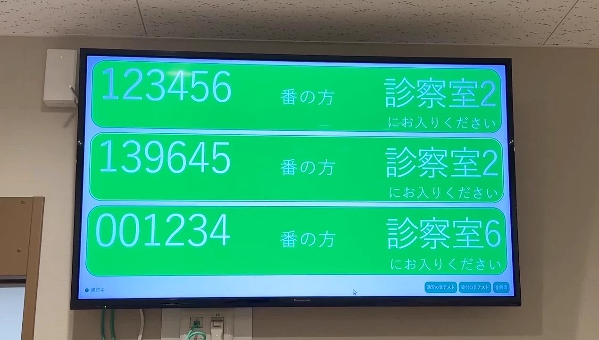
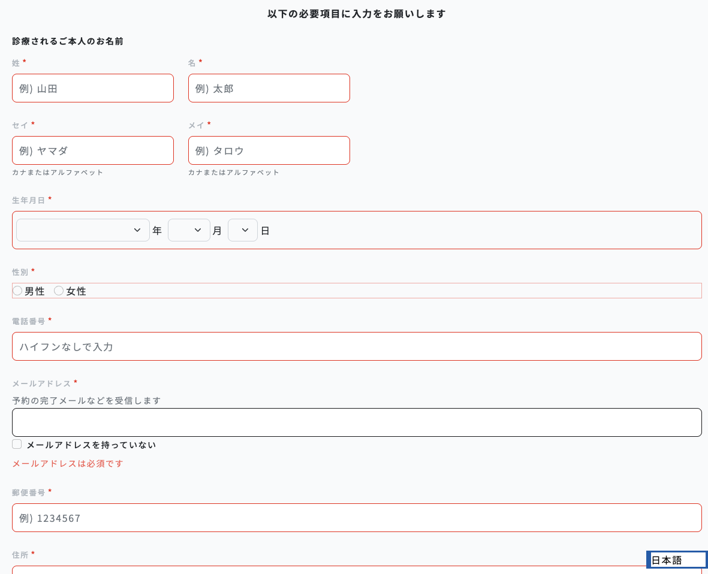
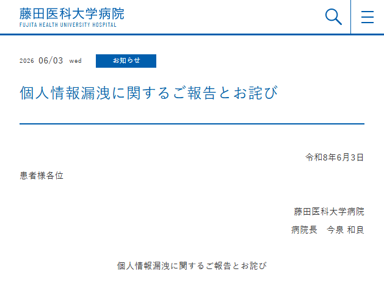
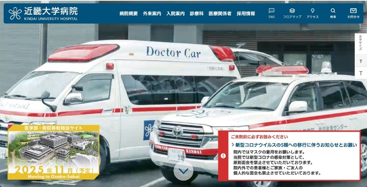

<!-- _class: title-slide -->

# プロトタイピングで ガンガン作って攻めるための、 最低限の身の丈セキュリティ話

第2回 ものづくり医療研究会

2026/11/15（日）13:45〜 ふれあい貸し会議室 秋葉原No53

---

<!-- _class: speaker-profile -->

# 菅原のびすけ

- プロトタイピングスクール「プロトアウトスタジオ」
- デジタルハリウッド大学大学院 非常勤講師
  - プロダクトプロトタイピング

個人活動

- IoTLT（国内最大のIoTコミュニティ）主催
- Developers Summit 2025 ベストスピーカー 1位
- LINE API Expert / Microsoft MVP / IBM Champion

---

<!-- _class: link-cards -->

# 産院の院長がChatGPTで患者呼び出しシステムを作った

<!-- card: https://x.com/A_Mochizuki/status/2111079943400808872 -->
<article class="gl-linkcard" data-card="https://x.com/A_Mochizuki/status/2111079943400808872"><strong class="t-sub"><a href="https://x.com/A_Mochizuki/status/2111079943400808872">産院のいんちょ (@A_Mochizuki) on X</a></strong><small class="t-note gl-muted">X (formerly Twitter) / 2026-10-16</small></article>

Pythonは書けないけど、院内LANから呼べる待合室の呼び出しシステム（@A_Mochizuki さん 2026/10/16）

<!-- 産院の院長の @A_Mochizuki さんが、Pythonのコードは一行も書けないけれど、ChatGPTに相談したら院内LANのどこからでも呼べる待合室の患者呼び出しシステムが作れた、と投稿していました（2026年10月16日）。翌日の投稿によると、アットリンクの障害の急場しのぎに作ったものだそうです。医療者が自分で作れる時代になっています。出典: https://x.com/A_Mochizuki/status/2111079943400808872 -->

---

<!-- _class: key-message -->

# 今日のメッセージ

セキュリティが心配だから作らない、ではなく

**「ここは意識してます」と自信を持って言えるから、 ガンガン作れる**

<!-- セキュリティを理由に開発を禁止したいわけではありません。リスクを理解したうえで、積極的にプロトタイピングするための考え方の話をします。「そもそも情報を集めていない」「分けてある」と自信を持って言えれば、プロトタイプでもガンガン作って攻められます。動くアプリと安全なアプリは違うので、どこを意識しているかを言えるようにしておきます。攻撃手法の細かい話より、非エンジニアでも設計の段階からできることを中心にします。 -->

---

<!-- _class: key-message -->

# 集めない

**持っていない情報は漏らせない**

<!-- 個人情報は漏らさないように守るだけでなく、そもそも要らないなら集めないほうがいい、という考え方です。 -->

---

<!-- _class: link-cards -->

# 予約の時点で、生年月日まで聞かれる

<!-- card: images/reservation-form.png | ある医療機関のWeb予約フォーム（必須：氏名・フリガナ・生年月日・性別・電話番号・メール・郵便番号・住所） -->
<article class="gl-linkcard is-image" data-card="images/reservation-form.png | ある医療機関のWeb予約フォーム（必須：氏名・フリガナ・生年月日・性別・電話番号・メール・郵便番号・住所）"><small class="t-note gl-muted">ある医療機関のWeb予約フォーム（必須：氏名・フリガナ・生年月日・性別・電話番号・メール・郵便番号・住所）</small></article>

来院したら、問診票でもまた生年月日を書く

<!-- ある医療機関のWeb予約フォームです。予約するだけなのに、氏名、フリガナ、生年月日、性別、電話番号、メールアドレス、郵便番号、住所がすべて必須になっていました。来院したら、問診票でもまた生年月日を書きます。予約の時点で、ここまで要るでしょうか。 -->

---

# 紙の問診票でも、生年月日とか無駄に聞くのはやめよう

- アプリでも紙でも、書いてもらった情報は持つことになる
- 紙もなくす、置き忘れる、見られる
- => 紙の問診票からも、要らない項目を消す

<!-- 問診をアプリではなく紙でやっているところもあります。紙だから安全というわけではなく、書いてもらった情報は持つことになります。紙の問診票でも、生年月日などを無駄に聞くのはやめよう、という話です。 -->

---

<!-- _class: link-cards -->

# 修学旅行で名簿の入ったリュックを紛失

<!-- card: https://news.yahoo.co.jp/articles/6517996581c146685dda087f9ee139a63fd6aff2 -->
<article class="gl-linkcard" data-card="https://news.yahoo.co.jp/articles/6517996581c146685dda087f9ee139a63fd6aff2"><strong class="t-sub"><a href="https://news.yahoo.co.jp/articles/6517996581c146685dda087f9ee139a63fd6aff2">修学旅行中に教員がリュックサックを紛失　2年生226人全員の個人情報流出の可能性　広島県立の高校で（RCC中国放送） - Yahoo!ニュース</a></strong><small class="t-note gl-muted">Yahoo!ニュース</small></article>

<!-- 広島県立の高校で、修学旅行中に教員が生徒の名簿などが入ったリュックサックをなくし、2年生226人全員の個人情報が流出した可能性があると報じられました（RCC中国放送、2026年10月）。紙でも、持ち歩けばなくします。出典: https://news.yahoo.co.jp/articles/6517996581c146685dda087f9ee139a63fd6aff2 -->

---

<!-- _class: key-message -->

# 持たない

毎回生年月日を入れさせたくない

でも、**DBには貯めたくない**

<!-- 問診フォームで毎回氏名や生年月日を入れてもらうのは面倒です。でも、便利にするためだけに生年月日をサーバーのDBに貯めるのも避けたい。生年月日は変えられず、他人に知られていることもあるので、認証のための秘密の情報としても向いていません。 -->

---

<!-- _class: link-cards -->

# 病院の個人PCでサポート詐欺

<!-- card: https://internet.watch.impress.co.jp/docs/news/2114633.html -->
<article class="gl-linkcard" data-card="https://internet.watch.impress.co.jp/docs/news/2114633.html"><strong class="t-sub"><a href="https://internet.watch.impress.co.jp/docs/news/2114633.html">愛知県の藤田医科大学病院で個人情報漏えいの可能性、規定に反して情報を持ち出した個人PCがサポート詐欺に</a></strong><small class="t-note gl-muted">INTERNET Watch / 2026-06-05</small></article>
<!-- card: https://scan.netsecurity.ne.jp/article/2024/05/22/51035.html -->
<article class="gl-linkcard" data-card="https://scan.netsecurity.ne.jp/article/2024/05/22/51035.html"><strong class="t-sub"><a href="https://scan.netsecurity.ne.jp/article/2024/05/22/51035.html">サポート詐欺で発覚 ～ 産婦人科医師が不適切な状態で患者データ保管 | ScanNetSecurity</a></strong><small class="t-note gl-muted">ScanNetSecurity</small></article>

<!-- 2026年6月、藤田医科大学病院で、看護師の個人PCがサポート詐欺の被害に遭い、院内の規定に反して保存していた患者の個人情報が漏えいした可能性があると発表されました。2024年5月には近畿大学病院でも、産婦人科の医師が研究目的で個人所有のPCに保存していた患者の情報が、サポート詐欺をきっかけに漏えいした可能性があると発表されています。出典: https://internet.watch.impress.co.jp/docs/news/2114633.html 、https://scan.netsecurity.ne.jp/article/2024/05/22/51035.html -->

---

# 2回目からはパスキーでログイン

- パスワードを作らせない
- 使い回しを防ぎやすい
- フィッシングに強い
- パスワード再設定を作らなくていい

参考: Setlogの登録画面

<!-- Setlogというアプリのユーザー登録が、パスキー中心の設計になっていて良いと感じました。何度も使う患者さんに毎回メールアドレスや生年月日を入れてもらう代わりに、パスキーでログインしてもらう、という使い方が考えられます。 -->

---

<!-- _class: zone-compare -->

# 患者DB・問診DB・対応表を分ける

<b>患者DB</b>
<ul class="t-sub"><li>患者ID</li><li>氏名</li><li>生年月日</li></ul>
漏れても問診内容は出ない

<b>問診DB</b>
<ul class="t-sub"><li>問診ID</li><li>症状、既往歴</li><li>暗号化</li></ul>
漏れても氏名は出ない

<b>対応表</b>
<ul class="t-sub"><li>患者IDと問診IDの対応だけ</li><li>別の場所に置く</li></ul>
見られる人を絞る

IDを分けただけでは匿名化にはならない

<!-- 患者DBだけが漏れても、問診内容までは直接漏れないようにします。問診DBだけが漏れても、氏名などを直接取られにくくします。対応表は別の保護された場所に置き、暗号鍵も問診DBとは別に管理します。ただし、自由記述や珍しい症状から患者さんを推測できる可能性は残ります。IDを分けただけでは、法的な意味での匿名化にはなりません。 -->

---

# DBだけじゃなく、サーバーや場所、ネットワークも分けておく

- 1\. 同じDBの中でテーブルを分ける
- 2\. 別のDBに分ける
- 3\. 別のサーバーに分ける
- 4\. 別のネットワーク・クラウド環境に分ける
- 5\. アカウント・アクセス権限を分ける
- 6\. 暗号鍵の管理も分ける

分けすぎると運用が大変になるので、身の丈で

<!-- 分け方にはいくつかの段階があります。同じDBの中でテーブルを分ける、別のDBにする、別のサーバーにする、別のネットワークやクラウド環境にする、アカウントやアクセス権限を分ける、暗号鍵の管理も分ける、という順に強くなります。保存する場所を分けることも対策になります。ただし、分けるほど運用の手間が増え、システムも複雑になるので、身の丈に合った段階を選びます。 -->

---

<!-- _class: key-message -->

# 集めない・持たない・分ける

**漏れても被害が小さくなる設計**

<!-- 侵入や漏洩を完全に防ぐことだけを目指すのではなく、侵害されたときにも被害が広がりにくい設計にしたい、という考え方です。 -->

---

# 「URLを知ってる人だけ」はアクセス制御じゃない

- robots.txt => セキュリティの仕組みじゃない
- noindex => 検索に出にくくするだけ
- => 見せたくないデータには**認証とアクセス制御**

例: ChatGPT の共有リンクの会話が、検索結果に出ていた（2025年8月）

<!-- 問診フォームの管理画面をURLを知っている人だけに共有する、院内の備品管理アプリを認証なしで公開する、といった使い方は危ないです。検索に出ないことと、外からアクセスできないことは違います。公開画面と管理画面を分け、患者情報を返すAPIにも権限の制御が必要です。2025年8月には、ChatGPT で「検索可能にする」を選んで共有した会話が検索エンジンに載っていたことが話題になり、OpenAI はその機能を取り下げました。参考: https://www.lifehacker.jp/article/2508-you-might-have-sent-your-chatgpt-conversations-to-google/ -->

---

# 学習に使われない ≠ ログが残らない

- ChatGPT Business / Enterprise => 原則、業務データを学習に使わない
- OpenAI API => デフォルトで学習に使わない
- Gemini API => 有料扱いかどうかで条件が変わる
- 試作は**ダミーデータ**で

規約は変わるので、使う前に公式のページで確認する

<!-- 学習に使われないことと、不正利用の監視などでログが保存されないことは別です。Gemini API は、単に無料か有料かではなく、Cloud Billing の設定や適用される契約条件を確認する必要があります。外部連携先に送った情報は、連携先のデータの扱いも考えます。試作の段階では、実際の患者情報ではなくダミーデータを使えないかをまず考えます。参考: https://openai.com/ja-JP/enterprise-privacy/ 、 https://ai.google.dev/gemini-api/terms?hl=ja -->

---

<!-- _class: closing -->

# まとめ

- 動くアプリと安全なアプリは違う
- **集めない・持たない・分ける**で、漏れても被害が小さい設計に
- 限定公開URLはアクセス制御じゃない

**=> 「そもそも集めてない」「分けてある」と自信を持って言えるようにして、ガンガン作ろう**
