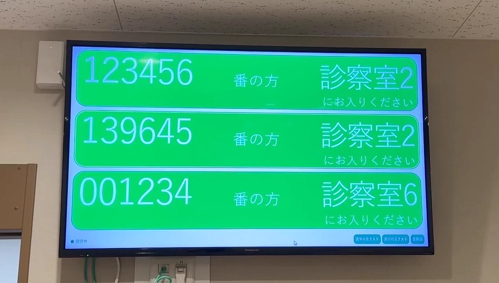

<!-- _class: title-slide -->

# 医療者もガンガン作ろう！ 作って試す時代の身の丈セキュリティ

第2回 ものづくり医療研究会

2026/11/15（日）13:45〜 ふれあい貸し会議室 秋葉原No53

菅原のびすけ @n0bisuke

---

<!-- _class: speaker-profile -->

# 菅原のびすけ

- プロトタイピングスクール「プロトアウトスタジオ」
- デジタルハリウッド大学大学院 非常勤講師
  - プロダクトプロトタイピング

個人活動

- IoTLT 主催
- Developers Summit 2025 ベストスピーカー 1位
- LINE API Expert / Microsoft MVP / IBM Champion

---

<!-- _class: link-cards -->

# 産院の院長がChatGPTで呼び出しシステムを作った

<article class="gl-linkcard" data-card="https://x.com/A_Mochizuki/status/2111079943400808872"><strong class="t-sub"><a href="https://x.com/A_Mochizuki/status/2111079943400808872">産院のいんちょ (@A_Mochizuki) on X</a></strong><small class="t-note gl-muted">X / 2026-10-16</small></article>

Pythonは書けないけど、院内LANから呼べる待合室の呼び出しシステム

<!-- Pythonは書けないけれど、ChatGPTに相談して院内LANで使える患者さんの呼び出しシステムを作った、という産院の院長の投稿です。作ってみること自体が、現場の課題を見つけている人の力になります。出典: https://x.com/A_Mochizuki/status/2111079943400808872 -->

---

<!-- _class: key-message -->

# 今日のメッセージ

**作って試す人を増やそう。**

設計の工夫も発信して、仲間と学び続けよう。

<!-- 今日の話は、作るのを止めるためのセキュリティではありません。作って試す人を増やすために、使う側、作る側、管理する側にできることを考えます。 -->

---

# 試作は、まずダミーデータで動かす

- 氏名 => 患者A
- 生年月日 => 仮の日付
- 問診内容 => テスト用の例

<!-- 作る人は、最初から実際の患者さんのデータを使わないで、ダミーデータで画面や処理を試せます。実際の情報が必要になる段階が来たら、目的や扱いを確認してから進みます。 -->

---

# AIが作ったフォームを、そのまま使わない

- その情報は何のため？
- 必須にする理由はある？
- 保存する必要はある？

<!-- AIにフォームを作らせると、よくある入力欄が一式ついてくることがあります。名前や生年月日を入れる前に、何に使うのか、必須なのか、保存するのかを考えます。 -->

---

# フォームは、必要な項目だけにする

- 入力が減る => 患者さんの手間が減る
- 持つ情報が減る => 守る情報も減る

<!-- 「フォームを作るな」ではなく、必要な項目だけのフォームにします。入力の負担や入力ミスが減り、作った側が守るデータも少なくできます。 -->

---

# 保存する情報と期間を決めておく

- そもそも保存しない
- 必要な期間が過ぎたら消す
- 便利だから、で残し続けない

<!-- データは、集めた時点だけでなく保存中も守らなければいけません。使う目的が終わったら削除できるか、最初に考えておくと運用も楽になります。タイムズカーの事例も、情報を持つ期間を見直すきっかけとして紹介しました。 -->

---

# 管理する人は、安全に試せる場を作る

- ダミーデータを使える
- 公開範囲を限定できる
- 本番のシステムや患者情報から切り離す

<!-- 管理者や組織には、禁止だけでなく、試作できる環境を用意する役割があります。ダミーデータで、公開範囲を限定して、本番環境から切り離して試せる場所があると、作る経験を安全に積みやすくなります。 -->

---

# 紙でも、情報は漏れる

- 紙をなくす
- 置き忘れる
- 見られる

<!-- 漏えいの原因はアプリだけではありません。紙の名簿や問診票も、なくしたり、置き忘れたり、第三者に見られたりします。道具を変えるだけで安全になるわけではなく、扱う人が仕組みを理解することが大事です。 -->

---

# だから、結局は教育です

- 作ってみる
- どこに情報があるか考える
- 失敗や工夫を共有する

<!-- これは僕の感覚ですが、ある程度安全な環境で実際にシステムを作ってみることが大切です。作る経験があると、データがどこに行くのか、誰が使えるのかを具体的に考えられるようになります。 -->

---

# 設計の工夫を、作った人から発信しよう

- 何を作った？
- どんな情報を集めないと決めた？
- どこまで試して、次に何を確認する？

<!-- 動くものだけでなく、どう設計したか、何を集めないと決めたか、まだ何を確認中かも発信すると、次に作る人の参考になります。自信を持って「ここは意識してます」と言えることを増やしていきましょう。 -->

---

# ひとりで抱えず、コミュニティで学ぼう

- もいせん
- プロトアウトスタジオ
- 医療者・開発者のコミュニティ

<!-- 作る経験やセキュリティの知識を、ひとりで抱え込まない。もいせんやプロトアウトスタジオ、医療者や開発者のコミュニティに参加して、作ったものや設計の工夫を見せ合いながら学び続けることにつなげたいです。 -->

---

<!-- _class: key-message stage -->

# 今日のメッセージ（再掲）

**作って試す人を増やそう。**

設計の工夫も発信して、仲間と学び続けよう。

---

<!-- _class: closing -->

# まとめ

- 医療者が作って試すのは、もっと進めたい
- まずはダミーデータで、安全に小さく試す
- 設計の工夫を発信して、仲間と学ぶ

**=> 今日のアイデアをひとつ作って、設計の工夫も共有しよう。**
