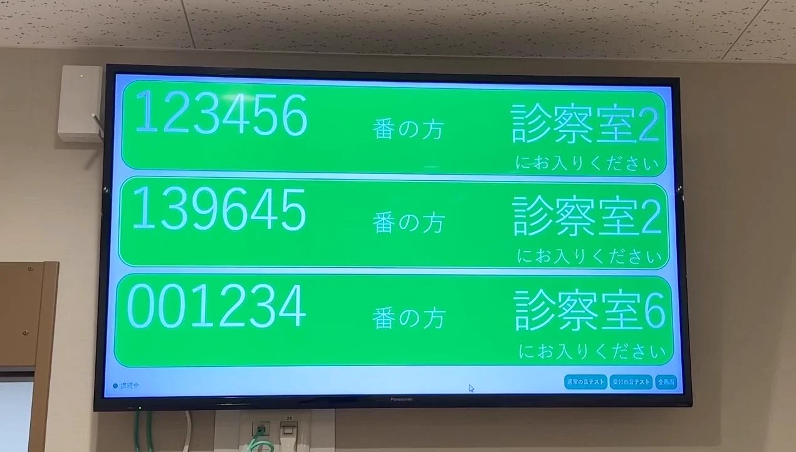
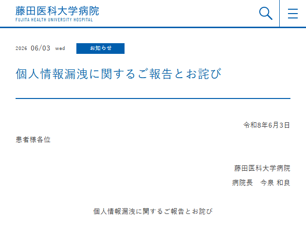
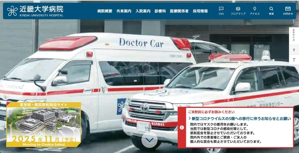
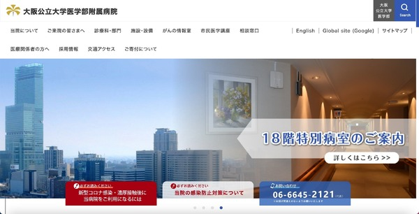
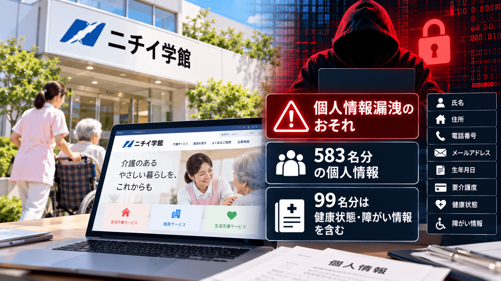
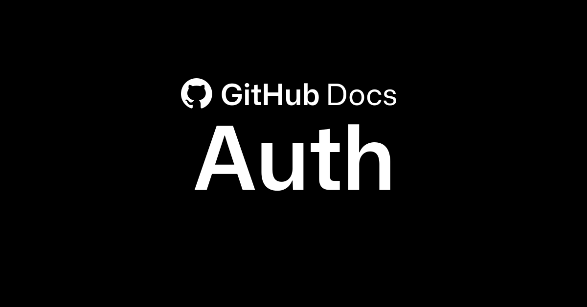
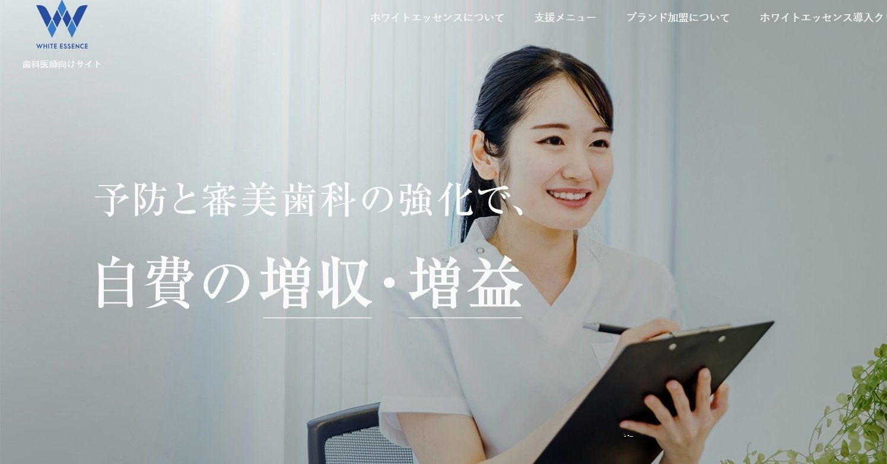
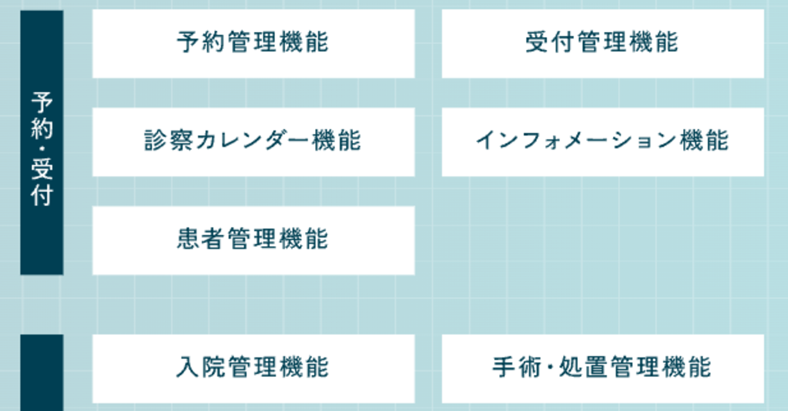
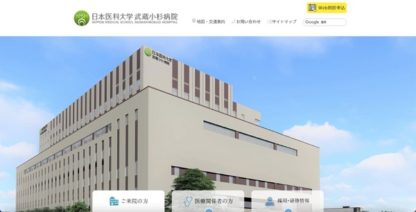
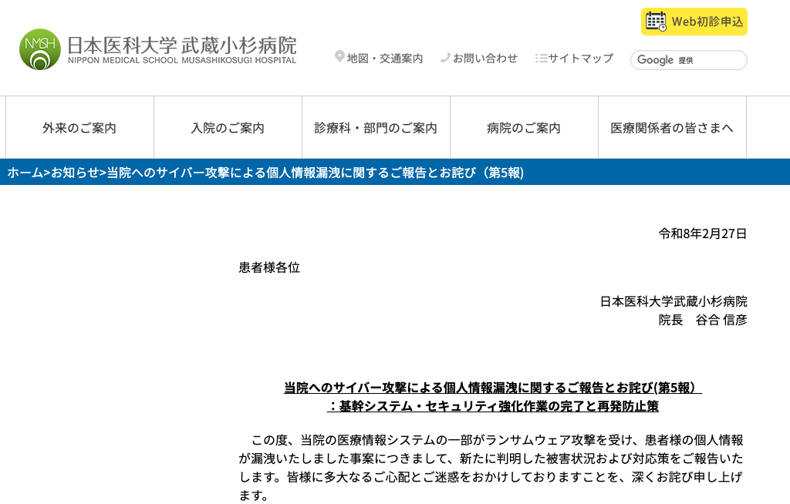

<!-- _class: title-slide -->


# プロトタイピングで<br>ガンガン作って攻めるための、<br>最低限の身の丈セキュリティ話

第2回 ものづくり医療研究会

2026/11/15（日）13:45〜 ふれあい貸し会議室 秋葉原No53

---

<!-- _class: speaker-profile -->


# 菅原のびすけ

- プロトタイピングスクール「プロトアウトスタジオ」
- デジタルハリウッド大学大学院 非常勤講師
  - プロダクトプロトタイピング

個人活動

- IoTLT（国内最大のIoTコミュニティ）主催
- Developers Summit 2025 ベストスピーカー 1位
- LINE API Expert / Microsoft MVP / IBM Champion

---

# AIで医療者もアプリが作れる時代ですね

- 受付・順番待ちシステム
- 問診フォーム
- 院内の業務改善アプリ

<!-- 生成AIやバイブコーディングで、プログラミングの専門知識がなくてもアプリを作れるようになってきています。医療者自身が作りそうなものとして、受付や順番待ちのシステム、問診フォーム、院内の業務改善アプリなどがあります。 -->

---

<!-- _class: link-cards -->

# 産院の院長がChatGPTで患者呼び出しシステムを作った

<!-- card: https://x.com/A_Mochizuki/status/2111079943400808872 -->
<article class="gl-linkcard" data-card="https://x.com/A_Mochizuki/status/2111079943400808872"><strong class="t-sub"><a href="https://x.com/A_Mochizuki/status/2111079943400808872">産院のいんちょ (@A_Mochizuki) on X</a></strong><small class="t-note gl-muted">X (formerly Twitter) / 2026-10-16</small></article>

<p class="gl-foot t-caption gl-muted">Pythonは書けないけど、院内LANから呼べる待合室の呼び出しシステム（@A_Mochizuki さん 2026/10/16）</p>

<!-- 産院の院長の @A_Mochizuki さんが、Pythonのコードは一行も書けないけれど、ChatGPTに相談したら院内LANのどこからでも呼べる待合室の患者呼び出しシステムが作れた、と投稿していました（2026年10月16日）。翌日の投稿によると、アットリンクの障害の急場しのぎに作ったものだそうです。医療者が自分で作れる時代になっています。出典: https://x.com/A_Mochizuki/status/2111079943400808872 -->

---

<!-- _class: key-message -->

# 今日のメッセージ

セキュリティが心配だから作らない、ではなく

**「ここは意識してます」と自信を持って言えるから、<br>ガンガン作れる**

<!-- セキュリティを理由に開発を禁止したいわけではありません。リスクを理解したうえで、積極的にプロトタイピングするための考え方の話をします。「そもそも情報を集めていない」「分けてある」と自信を持って言えれば、プロトタイプでもガンガン作って攻められます。動くアプリと安全なアプリは違うので、どこを意識しているかを言えるようにしておきます。攻撃手法の細かい話より、非エンジニアでも設計の段階からできることを中心にします。 -->

---

<!-- _class: agenda overview -->

# 今日のアジェンダ

- 1\. 集めない
- 2\. 持たない
- 3\. 分ける
- 4\. 身の丈の運用
- 5\. まとめ

---

<!-- _class: agenda -->

# 今日のアジェンダ

- **1\. 集めない**
- 2\. 持たない
- 3\. 分ける
- 4\. 身の丈の運用
- 5\. まとめ

---

# AIに受付システムを作らせると、とりあえず全部聞いてくる

- 氏名
- 生年月日
- メールアドレス
- 電話番号

<!-- 一般的なフォームを作らせると、氏名、生年月日、メールアドレス、電話番号などを取得する実装になりがちです。 -->

---

# 順番を管理するだけなら受付番号で済むかも

- 氏名・生年月日・メール・電話 => **A-023**
- 患者さんとの対応が必要なら、既存の受付システム側で持てないか

<p class="gl-foot t-caption gl-muted">受付番号も患者さんと結び付くなら個人情報になり得る</p>

<!-- 単に順番を管理する目的なら、受付番号だけで済む可能性があります。患者さんには「A-023」のような番号を表示して、今呼ばれている番号や待ち状況だけを知らせます。受付番号と患者情報の対応が必要なら、既存の受付システム側で管理できないかを考えます。ただし、受付番号も患者と結び付くなら個人情報になり得るので、完全な匿名化ではありません。 -->

---

<!-- _class: key-message -->

# 集めない

**持っていない情報は漏らせない**

<!-- 個人情報は漏らさないように守るだけでなく、そもそも要らないなら集めないほうがいい、という考え方です。 -->

---

# その項目、本当に要りますか？

- メールアドレス、氏名、電話番号、要る？
- 住所や生年月日まで取る理由ある？
- そもそもユーザー登録、要る？
- 保存する必要ある？ いつ消す？
- 自由記述じゃなくて選択式にできない？

---

# 紙の問診票でも、生年月日とか無駄に聞くのはやめよう

- アプリでも紙でも、書いてもらった情報は持つことになる
- 紙もなくす、置き忘れる、見られる
- => 紙の問診票からも、要らない項目を消す

<!-- 問診をアプリではなく紙でやっているところもあります。紙だから安全というわけではなく、書いてもらった情報は持つことになります。紙の問診票でも、生年月日などを無駄に聞くのはやめよう、という話です。 -->

---

<!-- _class: link-cards -->

# 修学旅行で名簿の入ったリュックを紛失

<!-- card: https://news.yahoo.co.jp/articles/6517996581c146685dda087f9ee139a63fd6aff2 -->
<article class="gl-linkcard" data-card="https://news.yahoo.co.jp/articles/6517996581c146685dda087f9ee139a63fd6aff2"><strong class="t-sub"><a href="https://news.yahoo.co.jp/articles/6517996581c146685dda087f9ee139a63fd6aff2">修学旅行中に教員がリュックサックを紛失　2年生226人全員の個人情報流出の可能性　広島県立の高校で（RCC中国放送） - Yahoo!ニュース</a></strong><small class="t-note gl-muted">Yahoo!ニュース</small></article>

<!-- 広島県立の高校で、修学旅行中に教員が生徒の名簿などが入ったリュックサックをなくし、2年生226人全員の個人情報が流出した可能性があると報じられました（RCC中国放送、2026年10月）。紙でも、持ち歩けばなくします。出典: https://news.yahoo.co.jp/articles/6517996581c146685dda087f9ee139a63fd6aff2 -->

---

<!-- _class: source-cards -->

# 紙の名簿もなくすときはなくす 2026/10/20

<div class="gl-cards gl-cards--2">
<article class="gl-source"><strong class="t-body">修学旅行中に名簿の入ったリュックを紛失</strong><p class="t-sub">県立高校の修学旅行中に、引率の教員が、生徒の名簿などが入った私物のリュックを新横浜駅の付近に置き忘れた。2年生226名分の氏名と保護者の連絡先、108名分の健康調査表（治療中の病気や受診履歴など）が入っていた。</p><small class="t-note">広島県教育委員会 報道提供資料 / 2026年10月20日</small></article>
</div>
<p class="gl-foot t-note gl-muted">出典: 広島県教育委員会 https://www.pref.hiroshima.lg.jp/uploaded/attachment/686187.pdf</p>

<!-- 漏らされったー（https://morasaretter.suke.dev/）で見つけた事例です。広島県教育委員会の報道提供資料（2026年10月20日）によると、県立大門高校の2年生の修学旅行の最終日（10月9日）、引率の教員が新横浜駅東口の解散式の付近に私物のリュックサックを置き忘れました。中には、2年生226名分のクラス・氏名・保護者の連絡先、108名分の健康調査表（治療中の病気や受診履歴、服薬状況、アレルギーなど）、生徒の写真データが入ったiPadなどがありました。紙の名簿でも、持ち歩けばなくします。そして健康調査表のように、集めた情報が多いほど、なくしたときの被害も大きくなります。出典: https://www.pref.hiroshima.lg.jp/uploaded/attachment/686187.pdf -->

---

# フォームを減らすと入力も実装も楽になる

- 入力が減る => 患者さんが楽、入力ミスも減る
- 項目が減る => 実装も保存も削除も楽
- => **セキュリティとUXはトレードオフじゃない**

<!-- フォームを減らすと、入力の負担が減り、使い始めるまでの時間が短くなり、入力ミスも減ります。作る側も、実装や保存・削除・管理の手間が減ります。セキュリティを強くすることが、そのままユーザー体験の改善にもなります。 -->

---

<!-- _class: actor-flow -->

# AIが作ったフォームから、人間が項目を削る

<div class="gl-flow">
<div class="gl-step gl-step--human"><i class="gl-icon gl-icon--human"></i><div class="gl-box t-sub"><span>受付システム<br>作って</span></div></div><div class="gl-arrow t-sub">→</div><div class="gl-step gl-step--ai"><i class="gl-icon gl-icon--robot"></i><div class="gl-box t-sub"><span>フォームを<br>生成</span></div></div><div class="gl-arrow gl-arrow--alert t-note">判断<br>→</div><div class="gl-step gl-step--human"><i class="gl-icon gl-icon--human"></i><div class="gl-box t-sub"><span>要らない<br>項目を削る</span></div></div>
</div>
<p class="gl-foot t-caption gl-muted">作らない機能を決めることもセキュリティ設計</p>

<!-- AIが自動で作ったフォームをそのまま採用せず、要らない項目や機能を人間が削る判断が大事です。 -->

---

<!-- _class: agenda -->

# 今日のアジェンダ

- 1\. 集めない
- **2\. 持たない**
- 3\. 分ける
- 4\. 身の丈の運用
- 5\. まとめ

---

<!-- _class: key-message -->

# 持たない

毎回生年月日を入れさせたくない

でも、**DBには貯めたくない**

<!-- 問診フォームで毎回氏名や生年月日を入れてもらうのは面倒です。でも、便利にするためだけに生年月日をサーバーのDBに貯めるのも避けたい。生年月日は変えられず、他人に知られていることもあるので、認証のための秘密の情報としても向いていません。 -->

---

<!-- _class: link-cards -->

# 病院の個人PCでサポート詐欺

<!-- card: https://internet.watch.impress.co.jp/docs/news/2114633.html -->
<article class="gl-linkcard" data-card="https://internet.watch.impress.co.jp/docs/news/2114633.html"><strong class="t-sub"><a href="https://internet.watch.impress.co.jp/docs/news/2114633.html">愛知県の藤田医科大学病院で個人情報漏えいの可能性、規定に反して情報を持ち出した個人PCがサポート詐欺に</a></strong><small class="t-note gl-muted">INTERNET Watch / 2026-06-05</small></article>
<!-- card: https://scan.netsecurity.ne.jp/article/2024/05/22/51035.html -->
<article class="gl-linkcard" data-card="https://scan.netsecurity.ne.jp/article/2024/05/22/51035.html"><strong class="t-sub"><a href="https://scan.netsecurity.ne.jp/article/2024/05/22/51035.html">サポート詐欺で発覚 ～ 産婦人科医師が不適切な状態で患者データ保管 | ScanNetSecurity</a></strong><small class="t-note gl-muted">ScanNetSecurity</small></article>

<!-- 2026年6月、藤田医科大学病院で、看護師の個人PCがサポート詐欺の被害に遭い、院内の規定に反して保存していた患者の個人情報が漏えいした可能性があると発表されました。2024年5月には近畿大学病院でも、産婦人科の医師が研究目的で個人所有のPCに保存していた患者の情報が、サポート詐欺をきっかけに漏えいした可能性があると発表されています。出典: https://internet.watch.impress.co.jp/docs/news/2114633.html 、https://scan.netsecurity.ne.jp/article/2024/05/22/51035.html -->

---

<!-- _class: source-cards -->

# 患者情報を個人PCに置いていたら、サポート詐欺

<div class="gl-cards gl-cards--2">
<article class="gl-source"><strong class="t-body">看護師の個人PCが遠隔操作された</strong><p class="t-sub">院内規定に反して個人PCに保存していた患者情報（氏名、生年月日、病名、検査データなど1,365件）が漏えいした可能性。</p><small class="t-note">藤田医科大学病院の発表 / INTERNET Watch / 2026年6月3日</small></article>
<article class="gl-source"><strong class="t-body">医師の個人PCがサポート詐欺に</strong><p class="t-sub">研究目的で集めた患者の個人情報が、個人所有のパソコンに保存されていたことが分かった。</p><small class="t-note">近畿大学病院の発表 / ScanNetSecurity / 2024年5月13日</small></article>
</div>
<p class="gl-foot t-note gl-muted">参考: 漏らされったー https://morasaretter.suke.dev/</p>

<!-- 藤田医科大学病院では、看護師が院内規定に反して患者の個人情報を個人PCに保存していました。閲覧中に出た警告表示の連絡先に連絡し、遠隔操作を受けたことで、氏名、性別、生年月日、患者ID、病名、入退院日、検査データなど1,365件が漏えいした可能性があります（INTERNET Watch 2026年6月5日、病院の発表は6月3日）。近畿大学病院では、産婦人科の医師が個人所有のパソコンでサポート詐欺の被害に遭い、調べる中で研究目的で集めた患者の個人情報がそのパソコンに保存されていたことが分かりました（ScanNetSecurity 2024年5月22日、病院の発表は5月13日）。参考: https://internet.watch.impress.co.jp/docs/news/2114633.html 、 https://scan.netsecurity.ne.jp/article/2024/05/22/51035.html -->

---

<!-- _class: source-cards -->

# USBメモリもなくす

<div class="gl-cards gl-cards--2">
<article class="gl-source"><strong class="t-body">患者情報入りのUSBメモリを一時紛失</strong><p class="t-sub">医師が使っていた、患者の氏名・患者ID・病名・入退院日などを記録したUSBメモリを一時紛失（のちに回収）。</p><small class="t-note">関西医科大学附属病院 / セキュリティ対策Lab / 2026年6月3日公表</small></article>
</div>

<!-- 関西医科大学附属病院で、脳神経内科の医師が使っていたUSBメモリを2026年2月に紛失していました。患者約1,800人分の氏名、患者ID、病名、入退院日などが記録されていて、数日後に見つかって回収されています。病院は漏えいの危険性は極めて低いとしています（2026年6月3日公表、セキュリティ対策Labの記事による）。持ち出せる形で持っていれば、なくすことがあります。出典: https://rocket-boys.co.jp/?p=34579 -->

---

# 2回目からはパスキーでログイン

- パスワードを作らせない
- 使い回しを防ぎやすい
- フィッシングに強い
- パスワード再設定を作らなくていい

<p class="gl-foot t-note gl-muted">参考: Setlogの登録画面</p>

<!-- Setlogというアプリのユーザー登録が、パスキー中心の設計になっていて良いと感じました。何度も使う患者さんに毎回メールアドレスや生年月日を入れてもらう代わりに、パスキーでログインしてもらう、という使い方が考えられます。 -->

---

<!-- _class: zone-compare -->

# ログインできる ≠ 患者本人

<div class="gl-zones">
<div class="gl-zone"><p class="t-sub"><b>ログイン認証</b></p><ul class="t-sub"><li>パスキー</li><li>Google / Appleログイン</li></ul><p class="gl-out t-sub">そのアカウントを使っていい人か</p></div>
<div class="gl-zone"><p class="t-sub"><b>本人確認</b></p><ul class="t-sub"><li>初回に病院で確認</li><li>患者IDとアカウントを紐付け</li></ul><p class="gl-out t-sub">医療機関に登録された患者本人か</p></div>
</div>

<!-- パスキーでログインできても、その人が特定の患者本人とは限りません。初回は医療機関側で本人を確認し、患者IDとアプリのアカウントを紐付けてパスキーを登録します。2回目以降はパスキーでログインして、今回の症状だけを入力してもらいます。 -->

---

# 受付QR＋一時トークンで問診フォームを開く

- 1\. 受付で患者さんごとのQRを発行
- 2\. スマホで問診フォームを開いて回答
- 3\. 回答は問診IDに紐付けて保存
- 4\. 患者IDとの対応は既存の患者管理システム側で

<p class="gl-foot t-caption gl-muted">QRを持っているだけで本人とは言い切れない（渡し間違い、転送、盗撮）</p>

<!-- QRコードには推測しにくい一時トークンを入れます。これなら問診フォームで毎回氏名や生年月日を入れてもらわずに済みます。ただし、QRを持っているだけで本人とは言い切れないので、渡し間違い、転送、盗撮への対策は必要です。 -->

---

<!-- _class: panel -->

# 入力補助だけなら、スマホ側に置く案も（検証途中）

- 生年月日などを Web Crypto API などで暗号化して患者さんのスマホに保存
- => 病院のDBには入力補助用の生年月日が無い
- 共用端末、端末紛失、XSS、鍵の管理はまだ課題

<!-- サーバーに集めず、患者さんのスマホ側に保存する方法も考えています。暗号化して端末内に保存し、必要なときだけ復号してフォームに入れる案です。サーバーのDBが漏れても、そこには入力補助用の生年月日がありません。ただし、共用端末、端末紛失、XSS、暗号鍵の管理といった課題があり、まだ検証途中です。 -->

---

<!-- _class: agenda -->

# 今日のアジェンダ

- 1\. 集めない
- 2\. 持たない
- **3\. 分ける**
- 4\. 身の丈の運用
- 5\. まとめ

---

<!-- _class: zone-compare -->

# 患者DB・問診DB・対応表を分ける

<div class="gl-zones">
<div class="gl-zone"><p class="t-sub"><b>患者DB</b></p><ul class="t-sub"><li>患者ID</li><li>氏名</li><li>生年月日</li></ul><p class="gl-out t-sub">漏れても問診内容は出ない</p></div>
<div class="gl-zone"><p class="t-sub"><b>問診DB</b></p><ul class="t-sub"><li>問診ID</li><li>症状、既往歴</li><li>暗号化</li></ul><p class="gl-out t-sub">漏れても氏名は出ない</p></div>
<div class="gl-zone"><p class="t-sub"><b>対応表</b></p><ul class="t-sub"><li>患者IDと問診IDの対応だけ</li><li>別の場所に置く</li></ul><p class="gl-out t-sub">見られる人を絞る</p></div>
</div>
<p class="gl-foot t-caption gl-muted">IDを分けただけでは匿名化にはならない</p>

<!-- 患者DBだけが漏れても、問診内容までは直接漏れないようにします。問診DBだけが漏れても、氏名などを直接取られにくくします。対応表は別の保護された場所に置き、暗号鍵も問診DBとは別に管理します。ただし、自由記述や珍しい症状から患者さんを推測できる可能性は残ります。IDを分けただけでは、法的な意味での匿名化にはなりません。 -->

---

# DBだけじゃなく、サーバーや場所、ネットワークも分けておく

- 1\. 同じDBの中でテーブルを分ける
- 2\. 別のDBに分ける
- 3\. 別のサーバーに分ける
- 4\. 別のネットワーク・クラウド環境に分ける
- 5\. アカウント・アクセス権限を分ける
- 6\. 暗号鍵の管理も分ける

<p class="gl-foot t-caption gl-muted">分けすぎると運用が大変になるので、身の丈で</p>

<!-- 分け方にはいくつかの段階があります。同じDBの中でテーブルを分ける、別のDBにする、別のサーバーにする、別のネットワークやクラウド環境にする、アカウントやアクセス権限を分ける、暗号鍵の管理も分ける、という順に強くなります。保存する場所を分けることも対策になります。ただし、分けるほど運用の手間が増え、システムも複雑になるので、身の丈に合った段階を選びます。 -->

---

<!-- _class: key-message -->

# 分ける

分けるだけじゃダメ

**全部見られるアプリが乗っ取られたら、全部取られる**

<!-- 別のサーバーに分けても、1つのアプリからすべてのDBにアクセスできるなら、そのアプリが乗っ取られたときに全部取得できてしまいます。 -->

---

# 鍵と権限も分ける

- アプリごとに必要なDBにだけアクセスさせる
- 患者情報と問診内容を取るAPIを分ける
- 受付スタッフと医師で見える情報を分ける
- 一括ダウンロードと管理者権限を絞る
- ログやバックアップにも個人情報が残る

<!-- 保管場所を分けるだけでなく、情報にアクセスできる権限を分けることが大事です。分けすぎると運用が大変になり、システムも複雑になるので、そこも考えます。 -->

---

<!-- _class: key-message -->

# 集めない・持たない・分ける

**漏れても被害が小さくなる設計**

<!-- 侵入や漏洩を完全に防ぐことだけを目指すのではなく、侵害されたときにも被害が広がりにくい設計にしたい、という考え方です。 -->

---

<!-- _class: agenda -->

# 今日のアジェンダ

- 1\. 集めない
- 2\. 持たない
- 3\. 分ける
- **4\. 身の丈の運用**
- 5\. まとめ

---

# 「URLを知ってる人だけ」はアクセス制御じゃない

- robots.txt => セキュリティの仕組みじゃない
- noindex => 検索に出にくくするだけ
- => 見せたくないデータには**認証とアクセス制御**

<p class="gl-foot t-note gl-muted">例: ChatGPT の共有リンクの会話が、検索結果に出ていた（2025年8月）</p>

<!-- 問診フォームの管理画面をURLを知っている人だけに共有する、院内の備品管理アプリを認証なしで公開する、といった使い方は危ないです。検索に出ないことと、外からアクセスできないことは違います。公開画面と管理画面を分け、患者情報を返すAPIにも権限の制御が必要です。2025年8月には、ChatGPT で「検索可能にする」を選んで共有した会話が検索エンジンに載っていたことが話題になり、OpenAI はその機能を取り下げました。参考: https://www.lifehacker.jp/article/2508-you-might-have-sent-your-chatgpt-conversations-to-google/ -->

---

<!-- _class: link-cards -->

# 介護・医療の設定ミス

<!-- card: https://www.pref.fukuoka.lg.jp/press-release/nkojinjyouhou.html -->
<article class="gl-linkcard" data-card="https://www.pref.fukuoka.lg.jp/press-release/nkojinjyouhou.html"><strong class="t-sub"><a href="https://www.pref.fukuoka.lg.jp/press-release/nkojinjyouhou.html">福岡県働きやすい介護職場認証制度事業における個人情報の漏えい事案について - 福岡県庁ホームページ</a></strong><small class="t-note gl-muted">福岡県庁ホームページ</small></article>
<!-- card: https://scan.netsecurity.ne.jp/article/2024/12/16/52044.html -->
<article class="gl-linkcard" data-card="https://scan.netsecurity.ne.jp/article/2024/12/16/52044.html"><strong class="t-sub"><a href="https://scan.netsecurity.ne.jp/article/2024/12/16/52044.html">表示されるべきでない患者一覧が閲覧可能に ～ 大阪公立大学医学部附属病院 | ScanNetSecurity</a></strong><small class="t-note gl-muted">ScanNetSecurity</small></article>
<!-- card: https://rocket-boys.co.jp/security-measures-lab/nichii-kaigo-personal-data-exposure-20261002/ -->
<article class="gl-linkcard" data-card="https://rocket-boys.co.jp/security-measures-lab/nichii-kaigo-personal-data-exposure-20261002/"><strong class="t-sub"><a href="https://rocket-boys.co.jp/security-measures-lab/nichii-kaigo-personal-data-exposure-20261002/">ニチイ学館、介護サイトで個人情報漏洩のおそれ―583名分、99名は健康状態・障がい情報を含む|セキュリティニュースのセキュリティ対策Lab</a></strong><small class="t-note gl-muted">合同会社ロケットボーイズ - セキュリティ 情報漏洩のニュースサイト セキュリティ対策Labの運営とBtoB マーケティング コンサル 支援 / 2026-10-06</small></article>

<!-- 福岡県では、介護職場認証制度の申請用ファイルの設定を委託先が誤り、介護事業者の役員183人分の氏名や生年月日が閲覧できる状態でした（2026年9月）。大阪公立大学医学部附属病院では、地域医療連携ネットワークの設定不備で、本来表示されないはずの患者一覧が見られる状態でした（2024年12月）。ニチイ学館では、介護サイトのお問い合わせデータを含むバックアップファイルが、認証なしで外部から取得できる状態だったと報じられています（2026年10月、583名分、セキュリティ対策Labの記事による）。出典: https://www.pref.fukuoka.lg.jp/press-release/nkojinjyouhou.html 、https://scan.netsecurity.ne.jp/article/2024/12/16/52044.html 、https://rocket-boys.co.jp/security-measures-lab/nichii-kaigo-personal-data-exposure-20261002/ -->

---

<!-- _class: source-cards -->

# 設定ミスで「誰でも見られる」状態に

<div class="gl-cards gl-cards--3">
<article class="gl-source"><strong class="t-body">介護サイトの問い合わせデータ</strong><p class="t-sub">バックアップファイルが2020年5月から2026年9月まで認証なしで取得できる状態だった。健康状態や障がいの情報も。</p><small class="t-note">ニチイ学館 / セキュリティ対策Lab / 2026年10月</small></article>
<article class="gl-source"><strong class="t-body">介護職場認証の申請ファイル</strong><p class="t-sub">委託先がファイルの設定を誤り、役員183人分の氏名・生年月日などが閲覧できる状態だった。</p><small class="t-note">福岡県 報道発表 / NHK / 2026年9月29日</small></article>
<article class="gl-source"><strong class="t-body">地域医療連携ネットワーク</strong><p class="t-sub">設定の不備で、本来表示されないはずの患者一覧が閲覧できる状態だった。</p><small class="t-note">大阪公立大学医学部附属病院 / ScanNetSecurity / 2024年12月</small></article>
</div>
<p class="gl-foot t-note gl-muted">参考: 漏らされったー https://morasaretter.suke.dev/</p>

<!-- ニチイ学館の介護サイトでは、お問い合わせデータを含むバックアップファイルが、2020年5月から2026年9月まで外部から取得できる状態でした。福岡県では、介護職場認証制度の申請受付を委託した事業者が申請用ファイルの設定を誤り、介護事業者24法人の役員183人分の氏名・生年月日・性別・役職が閲覧できる状態でした。大阪公立大学医学部附属病院では、地域医療連携ネットワークの設定不備で、本来表示されるべきでない患者一覧が閲覧できる状態でした。出典: 福岡県 https://www.pref.fukuoka.lg.jp/press-release/nkojinjyouhou.html 、大阪公立大学医学部附属病院 https://hosp.omu.ac.jp/doc/20241202-info-important.pdf 、ニチイ学館の件は https://rocket-boys.co.jp/security-measures-lab/nichii-kaigo-personal-data-exposure-20261002/ -->

---

# Privateリポジトリでも、アカウントが乗っ取られたら見られる

- GitHubにパスキーか二要素認証を設定
- Privateでも APIキーは置かない
- 繋いだAIツールやトークンの権限を見直す

<!-- リポジトリをPrivateにしていても、GitHubアカウントの認証が弱ければ安全とはいえません。誤って秘密情報をコミットしたときは、ファイルを消すだけでは足りず、履歴の対応とキーの失効・再発行が必要です。個人のGitHubで医療関連のシステムを作るなら、組織のルールやコードの所有権も確認が必要です。 -->

---

<!-- _class: link-cards -->

# GitHubはパスキーでログインできる

<!-- card: https://docs.github.com/ja/authentication/authenticating-with-a-passkey/about-passkeys -->
<article class="gl-linkcard" data-card="https://docs.github.com/ja/authentication/authenticating-with-a-passkey/about-passkeys"><strong class="t-sub"><a href="https://docs.github.com/ja/authentication/authenticating-with-a-passkey/about-passkeys">パスキーの概要 - GitHubドキュメント</a></strong><small class="t-note gl-muted">GitHub Docs</small></article>

<!-- コードを置く GitHub も、パスキーでログインできます。Privateリポジトリでも、アカウントを乗っ取られれば中身は見られてしまうので、ログインの方法から固めておきます。出典: https://docs.github.com/ja/authentication/authenticating-with-a-passkey/about-passkeys -->

---

# 普通の入力フォームが攻撃の入口になる

```sql
SELECT * FROM reception
WHERE number = '' OR '1'='1'
```

<p class="gl-foot t-caption gl-muted">受付番号の欄に ' OR '1'='1 と入れると、全員分が出てくる（架空のDBの例）</p>

<!-- 病院の受付番号検索フォームを例にします。入力をそのままSQLに組み立てる実装だと、条件が常に成り立って、本来表示するべきでないレコードまで取れてしまいます。AIが生成したコードも安全とは限りません。パラメータ化クエリなどの対策が必要です。 -->

---

<!-- _class: link-cards -->

# 予約サイト、患者アプリ、問診データ

<!-- card: https://www.itmedia.co.jp/news/article/2610/05/2000002016/ -->
<article class="gl-linkcard" data-card="https://www.itmedia.co.jp/news/article/2610/05/2000002016/"><strong class="t-sub"><a href="https://www.itmedia.co.jp/news/article/2610/05/2000002016/">ホワイトエッセンス、約105万アカウントの個人情報流出　8月発表の不正アクセス調査で判明</a></strong><small class="t-note gl-muted">ITmedia NEWS</small></article>
<!-- card: https://www.itmedia.co.jp/news/article/2610/15/2000002293/ -->
<article class="gl-linkcard" data-card="https://www.itmedia.co.jp/news/article/2610/15/2000002293/"><strong class="t-sub"><a href="https://www.itmedia.co.jp/news/article/2610/15/2000002293/">メドレーの産婦人科向けシステムに不正アクセス、患者の個人情報漏えいか　最大787の医療機関が対象</a></strong><small class="t-note gl-muted">ITmedia NEWS</small></article>
<!-- card: https://www.nikkei.com/article/DGXZQOUC069010W6A101C2000000/ -->
<article class="gl-linkcard" data-card="https://www.nikkei.com/article/DGXZQOUC069010W6A101C2000000/"><strong class="t-sub"><a href="https://www.nikkei.com/article/DGXZQOUC069010W6A101C2000000/">資生堂、利用者情報が2515件流出　肌の測定結果など - 日本経済新聞</a></strong><small class="t-note gl-muted">日本経済新聞 / 2026-11-06</small></article>

<!-- ホワイトエッセンスでは、予約サイトの脆弱性を足がかりに基幹システムへ侵入され、約105万アカウント分の個人情報が持ち出されたと発表されました（2026年10月の続報）。メドレーの産婦人科向けサービス @link と患者向けアプリも不正アクセスを受け、最大787の医療機関の患者の個人情報が漏えいした可能性があります（2026年10月、調査中）。資生堂の肌測定システムでは、利用者2,515件の問診データや肌の測定結果が漏えいしました（2026年11月）。出典: https://www.itmedia.co.jp/news/article/2610/05/2000002016/ 、https://www.itmedia.co.jp/news/article/2610/15/2000002293/ 、https://www.nikkei.com/article/DGXZQOUC069010W6A101C2000000/ -->

---

<!-- _class: source-cards -->

# 予約サイトや患者アプリも狙われる

<div class="gl-cards gl-cards--3">
<article class="gl-source"><strong class="t-body">予約サイトから基幹システムへ</strong><p class="t-sub">予約サイトの脆弱性を足がかりに基幹システムへ侵入され、約105万アカウント分の氏名・生年月日などが持ち出された。</p><small class="t-note">ホワイトエッセンス / ITmedia NEWS / 2026年10月</small></article>
<article class="gl-source"><strong class="t-body">産婦人科向けサービスと患者アプリ</strong><p class="t-sub">医療機関向けサービスと患者向けアプリが不正アクセスを受けた。対象は最大787の医療機関、人数は調査中。</p><small class="t-note">メドレー @link / ITmedia NEWS / 2026年10月15日</small></article>
<article class="gl-source"><strong class="t-body">問診データも</strong><p class="t-sub">肌測定のシステムから、氏名・年齢・問診データ・肌測定結果など2,515件が漏えい。</p><small class="t-note">資生堂 / 日本経済新聞 / 2026年11月6日</small></article>
</div>
<p class="gl-foot t-note gl-muted">出典: ホワイトエッセンスの発表、ITmedia NEWS、日本経済新聞</p>

<!-- ホワイトエッセンスでは、予約サイトの脆弱性を足がかりに基幹システムへ侵入され、約105万アカウント分の情報が持ち出されたと10月の続報で発表しました。メドレーの産婦人科向けサービス「@link」と患者向けの「アットリンクアプリ」が不正アクセスを受け、患者の個人情報が漏えいした可能性があります。資生堂の肌測定システムからは、問診データを含む情報が漏えいしました。参考: https://www.whiteessence.com/news/news/20260812/ 、 https://www.itmedia.co.jp/news/article/2610/15/2000002293/ 、 https://www.nikkei.com/article/DGXZQOUC069010W6A101C2000000/ -->

---

<!-- _class: key-message -->

# 生成AIとの付き合い方

AIも一律に危ないわけじゃない

**契約と設定を見る**

<!-- 生成AIに情報を渡すのは全部危ない、という話で終わらせたくありません。契約・設定・使い方を確認すれば、安全性を確保しながら積極的に使えます。 -->

---

# 学習に使われない ≠ ログが残らない

- ChatGPT Business / Enterprise => 原則、業務データを学習に使わない
- OpenAI API => デフォルトで学習に使わない
- Gemini API => 有料扱いかどうかで条件が変わる
- 試作は**ダミーデータ**で

<p class="gl-foot t-note gl-muted">規約は変わるので、使う前に公式のページで確認する</p>

<!-- 学習に使われないことと、不正利用の監視などでログが保存されないことは別です。Gemini API は、単に無料か有料かではなく、Cloud Billing の設定や適用される契約条件を確認する必要があります。外部連携先に送った情報は、連携先のデータの扱いも考えます。試作の段階では、実際の患者情報ではなくダミーデータを使えないかをまず考えます。参考: https://openai.com/ja-JP/enterprise-privacy/ 、 https://ai.google.dev/gemini-api/terms?hl=ja -->

---

<!-- _class: link-cards -->

# 各社のデータの扱いは公式で確認する

<!-- card: https://ai.google.dev/gemini-api/terms?hl=ja -->
<article class="gl-linkcard" data-card="https://ai.google.dev/gemini-api/terms?hl=ja"><strong class="t-sub"><a href="https://ai.google.dev/gemini-api/terms?hl=ja">Google AI Studio</a></strong><small class="t-note gl-muted">aistudio.google.com</small></article>

<!-- 入力したデータが学習に使われるか、どれくらい保存されるかは、サービスや契約の種類によって違います。思い込みで判断せず、各社の公式のページで確認します。出典: https://openai.com/ja-JP/enterprise-privacy/ 、https://ai.google.dev/gemini-api/terms?hl=ja -->

---

<!-- _class: key-message -->

# 作ったあと

作ったあとも脆弱性は出てくる

**=> 誰が更新する？**

<!-- AIで病院の順番待ちシステムが作れて、動いています。でも、そのアプリを動かしているNode.jsに重大な脆弱性が見つかったら、誰が更新するのでしょうか。一度安全に作ったアプリも、ずっと安全とは限りません。ここでいう「最新にする」は、サポートされているバージョンを使い、セキュリティ修正を当てるという意味です。 -->

---

<!-- _class: link-cards -->

# 医療機器の保守用VPNからランサムウェア

<!-- card: https://scan.netsecurity.ne.jp/article/2026/03/09/54788.html -->
<article class="gl-linkcard" data-card="https://scan.netsecurity.ne.jp/article/2026/03/09/54788.html"><strong class="t-sub"><a href="https://scan.netsecurity.ne.jp/article/2026/03/09/54788.html">約13万人の患者情報が漏えい ～ 日本医科大学武蔵小杉病院へのランサムウェア攻撃 | ScanNetSecurity</a></strong><small class="t-note gl-muted">ScanNetSecurity</small></article>
<!-- card: https://internet.watch.impress.co.jp/docs/news/2090217.html -->
<article class="gl-linkcard" data-card="https://internet.watch.impress.co.jp/docs/news/2090217.html"><strong class="t-sub"><a href="https://internet.watch.impress.co.jp/docs/news/2090217.html">日本医科大学武蔵小杉病院、ランサムウェア被害の詳細および対策を発表、患者・職員約13万人の個人情報が漏えい</a></strong><small class="t-note gl-muted">INTERNET Watch / 2026-03-04</small></article>

<!-- 日本医科大学武蔵小杉病院では、医療機器の保守用のVPN装置から侵入され、ナースコール管理サーバーがランサムウェアに感染し、患者・職員約13万人の個人情報が漏えいしました（2026年2月〜3月の発表）。作ったあとの保守の入口も、攻撃の入口になります。出典: https://scan.netsecurity.ne.jp/article/2026/03/09/54788.html 、https://internet.watch.impress.co.jp/docs/news/2090217.html -->

---

<!-- _class: source-cards -->

# 保守用の入口や、捨て方からも漏れる

<div class="gl-cards gl-cards--2">
<article class="gl-source"><strong class="t-body">医療機器の保守用VPNから侵入</strong><p class="t-sub">ナースコール管理サーバーがランサムウェアに感染し、患者約13万人の氏名・住所・生年月日などが漏えい。</p><small class="t-note">日本医科大学武蔵小杉病院 / ScanNetSecurity / 2026年2月〜3月</small></article>
<article class="gl-source"><strong class="t-body">データを消さずにフリマへ</strong><p class="t-sub">市立病院の個人データが入ったPOSレジを、委託関連事業者がデータを消さないままフリマアプリに出品した。</p><small class="t-note">気仙沼市立病院 / セキュリティ対策Lab / 2024年8月</small></article>
</div>
<p class="gl-foot t-note gl-muted">参考: 漏らされったー https://morasaretter.suke.dev/</p>

<!-- 日本医科大学武蔵小杉病院では、医療機器保守用のVPN装置から侵入され、ナースコール管理サーバーがランサムウェアに感染しました。当初は約1万人としていましたが、続報で患者約13万人の漏えいが判明しました（https://scan.netsecurity.ne.jp/article/2026/03/09/54788.html ）。気仙沼市では、市立病院で使っていたPOSレジ3台を、委託関連事業者がデータを消さないままフリマアプリに出品していました。2018年の移転のときに処分したレジで、患者4万8,651人分のIDやカナ氏名などが入っていました（セキュリティ対策Labの記事による）。参考: https://rocket-boys.co.jp/?p=7192 -->

---

# 自分のシステムが悪用される側にもなる

- 予約確認や呼び出しのメールを自作の仕組みで送る
- 送信の仕組みやAPIキーを乗っ取られる
- => 病院の名前で不審なメールが届く

<!-- 病院が予約確認や呼び出しのメールを送る仕組みを自作した場合、送信システムが乗っ取られたりAPIキーが漏れたりすると、病院の名前で不審なメールを送られる可能性があります。患者さんは病院からのメールだと思って信用するかもしれません。情報を漏らさないだけでなく、自分のシステムを他人に悪用されない、という観点も必要です。 -->

---

<!-- _class: link-cards -->

# メール配信サービス経由で医師の情報が

<!-- card: https://www.mixonline.jp/tabid55.html?artid=81069 -->
<article class="gl-linkcard" data-card="https://www.mixonline.jp/tabid55.html?artid=81069"><strong class="t-sub"><a href="https://www.mixonline.jp/tabid55.html?artid=81069">東邦HD子会社 医師氏名など約8000件が漏洩した可能性 外部メール配信サービスで不正アクセス被害 | ニュース | ミクスOnline</a></strong><small class="t-note gl-muted">mixonline.jp</small></article>
<!-- card: https://www.nikkei.com/article/DGXZQOUC237PD0T21C26A0000000/ -->
<article class="gl-linkcard" data-card="https://www.nikkei.com/article/DGXZQOUC237PD0T21C26A0000000/"><strong class="t-sub"><a href="https://www.nikkei.com/article/DGXZQOUC237PD0T21C26A0000000/">東邦HD子会社・eヘルスケア、個人情報8000件漏洩か　医師の氏名やアドレス - 日本経済新聞</a></strong><small class="t-note gl-muted">日本経済新聞 / 2026-10-23</small></article>

<!-- 東邦HDの子会社のeヘルスケアでは、メール配信に使っていた外部サービスが不正アクセスを受け、医師の氏名やメールアドレスなど約8000件が漏えいした可能性があると発表されました（2026年10月）。自分で作った部分だけでなく、使っている外部サービスからも漏れます。出典: https://www.mixonline.jp/tabid55.html?artid=81069 、https://www.nikkei.com/article/DGXZQOUC237PD0T21C26A0000000/ -->

---

<!-- _class: source-cards -->

# メール配信サービスからも漏れる

<div class="gl-cards gl-cards--2">
<article class="gl-source"><strong class="t-body">医師のメールアドレス約8000件</strong><p class="t-sub">メール配信に使っていたサービスが不正アクセスを受け、配信先リストなどが持ち出された可能性。</p><small class="t-note">eヘルスケア / 日本経済新聞・ミクスOnline / 2026年10月23日</small></article>
</div>

<!-- eヘルスケアでは、メール配信に使っていたブラストメールが不正アクセスを受け、医師の氏名とメールアドレス約8000件などが漏えいした可能性があります（https://www.mixonline.jp/tabid55.html?artid=81069 ）。 -->

---

<!-- _class: key-message stage -->

# 今日のメッセージ（再掲）

セキュリティが心配だから作らない、ではなく

**「ここは意識してます」と自信を持って言えるから、<br>ガンガン作れる**

---

<!-- _class: closing -->

# まとめ

- 動くアプリと安全なアプリは違う
- **集めない・持たない・分ける**で、漏れても被害が小さい設計に
- 限定公開URLはアクセス制御じゃない
- 作ったあとの更新まで考える

**=> 「そもそも集めてない」「分けてある」と自信を持って言えるようにして、ガンガン作ろう**
