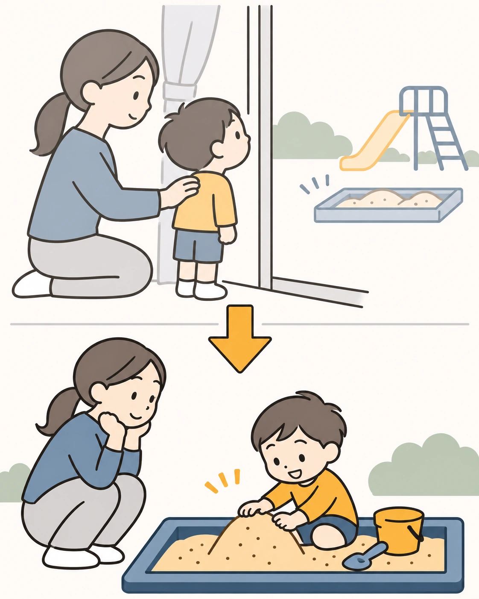

<!-- _class: title-slide -->

# 身の丈セキュリティで 現場から作って試そう

〜xxxxx〜

2026/12/16　会場・時間

菅原のびすけ @n0bisuke

---
<!-- _class: speaker-profile -->

## 菅原のびすけ

- プロトタイピングスクール「プロトアウトスタジオ」
- デジタルハリウッド大学大学院 非常勤講師
- IoTLT 主催
- ソフトウェアエンジニア出身

<!-- プロフィールは元LTの内容を仮で再利用しています。今回の聴講者に合わせて調整します。 -->

---
<!-- _class: key-message -->

## 今日のメッセージ

セキュリティを意識して、**現場から作って試そう。**

---
<!-- _class: agenda overview -->

## 今日の流れ

- 現場が作れる時代に、何が心配？
- 情報を小さく扱う設計
- Difyで問い合わせAIを試作
- 安全に試す場と、実運用の境界
- 明日からの一歩

<!-- 40分の講演を想定した仮の流れです。ハンズオンを会場で実施する場合は、講演時間と別枠にするか確認が必要です。 -->

---
<!-- _class: current-topic -->
<!-- _footer: 1. 現場が作れる時代に、何が心配？ -->

## 現場の人が、現場の困りごとを形にできる

- 受付・順番待ちの仕組み
- 問診フォーム
- 日々の業務を助ける小さなツール

<!-- 生成AIでいろいろ作れる時代です。現場を知っている人が、自分の困りごとを自分で形にできるのは大きな変化です。元LTでは、院内LANで使う呼び出しシステムや外来を助けるツールの事例を紹介しました。 -->

---
<!-- _class: source-cards current-topic -->
<!-- _footer: 1. 現場が作れる時代に、何が心配？ -->

## 医療の現場でも、自分たちで作り始めている

<article class="gl-source"><strong class="t-body">院内LANの呼び出しシステム</strong>
産院の院長がChatGPTに相談しながら作成。投稿では画面も紹介。
<small class="t-note"><a href="https://x.com/A_Mochizuki/status/2111079943400808872">産院のいんちょ / X / 2026年10月16日</a></small></article>
<article class="gl-source"><strong class="t-body">外来を助ける3つのツール</strong>
LINE問診、カルテ音声入力、セルフケア案内を制作。
<small class="t-note"><a href="https://note.com/dr_grid/n/nb44daadafdbf">Drグリッド / note / 2026年7月8日</a></small></article>

<!-- 元LTの事例を再掲します。中小企業向けの講演では、自社の現場に置き換えて聞いてもらいます。 -->

---
<!-- _class: media-split current-topic -->
<!-- _footer: 1. 現場が作れる時代に、何が心配？ -->

## 作った背景を知らずに、心配の声だけが届くこともある

- 「患者さんの情報が漏れたら怖い」
- 「そのシステム、大丈夫なの？」
- 心配は大事。でも、作るのを止めるだけでいい？

<!-- 既存サービスへの不正アクセスで院内システムが止まり、呼び出しシステムが使えなくなったことを背景に、自分で作った事例です。作ったものだけでなく、現場の事情も見て考えたいです。 -->

---
<!-- _class: key-message current-topic stage -->
<!-- _footer: 1. 現場が作れる時代に、何が心配？ -->

## 今日のメッセージ

セキュリティを意識して、**現場から作って試そう。**

<!-- 作らせないことだけを答えにせず、安全に試す条件を作りましょう。 -->

---
<!-- _class: current-topic -->
<!-- _footer: 2. 情報を小さく扱う設計 -->

## まず、データは漏れる前提で考える

- どこかに渡したデータは、後から制御しきれない
- だから最初に、渡す情報を減らす
- 必要がなければ、集めない・保存しない

<!-- 元LTの前提です。怖がるためではなく、漏れた時に困るものを最初から減らすために置いています。 -->

---
<!-- _class: media-split current-topic -->
<!-- _footer: 2. 情報を小さく扱う設計 -->

## フォームで聞く情報は、目的に合わせて小さくする

- 年代を知りたい => 生年月日ではなく年代
- 地域を知りたい => 必要な範囲まで
- 使わない項目は、必須にしない
- 持つ情報が減る => 守る情報も減る

<!-- 元LTでは、フォームで必要のない情報を必須にしないという例を出しました。今回の問い合わせAIでも同じ考えを使います。質問に個人名や顧客情報を書かなくても回答できるか、まず考えます。 -->

---
<!-- _class: media-split current-topic -->
<!-- _footer: 2. 情報を小さく扱う設計 -->

## 必要な情報も、保存する期間を決めておく

- そもそも保存しない
- 必要なら、保存場所と見られる人を決める
- 目的が終わったら消す
- 「便利だから」で残し続けない

<!-- データを使うなら、保存する必要があるか、いつ消すかを決めておきたいです。具体的な保存期間は業務や法令、社内ルールに照らして決めます。 -->

---
<!-- _class: current-topic -->
<!-- _footer: 2. 情報を小さく扱う設計 -->

## 今日作るのは、架空の社内規程問い合わせAI

- 社員が休暇・経費・備品のルールを質問
- AIは架空の規程文書をもとに回答
- 実在の社員情報や社内文書は使わない

<!-- ハンズオン題材は架空の会社「サンプル商事」と架空の規程にします。規程内容は研修用に用意する想定です。実際の規程や社員の質問ログは持ち込みません。 -->

---
<!-- _class: actor-flow current-topic locked -->
<!-- _footer: 3. Difyで問い合わせAIを試作 -->

## AIは規程を探して答える。人は範囲を決めて確かめる

問い合わせAIの流れ

<i class="gl-icon gl-icon--human"></i>
質問する

→

<i class="gl-icon gl-icon--robot"></i>
規程を探す

→

<i class="gl-icon gl-icon--robot"></i>
根拠つきで回答

→

<i class="gl-icon gl-icon--human"></i>
人が確認

試作では架空データとテスト質問だけを使う

<!-- この演習は本番サービスを完成させる時間ではなく、情報の流れを考えながら試作する時間です。 -->

---
<!-- _class: current-topic locked -->
<!-- _footer: 3. Difyで問い合わせAIを試作 -->

## 最初に、AIに渡さない情報を決める

- 実名・社員番号・顧客名は入力しない
- 実際の給与、健康、評価などの情報は使わない
- 架空の会社名と架空の規程だけで試す

<!-- 演習前に入力データを限定します。質問例も「有給休暇は何日ですか」のように個人を特定しない内容にします。Difyの利用環境・契約・設定は開催環境に応じて確認が必要です。 -->

---
<!-- _class: current-topic locked -->
<!-- _footer: 3. Difyで問い合わせAIを試作 -->

## 架空の規程を、回答の根拠として用意する

- 休暇規程：申請期限、申請先
- 経費規程：対象範囲、上限、必要書類
- 備品規程：貸出方法、返却先
- 架空の数字・部署・役職で統一

<!-- 研修用に短い文書を数本用意します。内容は正解・不正解のテストができるよう明確にし、現実の会社の制度を推測して書きません。文書サンプルは要作成です。 -->

---
<!-- _class: current-topic locked -->
<!-- _footer: 3. Difyで問い合わせAIを試作 -->

## Difyに規程を登録し、知識として検索できるようにする

- 架空の規程ファイルを登録
- 分割や検索の設定を確認
- 回答に根拠が表示されるか試す

<!-- Difyの具体的な画面や設定名は、研修で使うバージョン・プランを確認して更新します。ここでは知識を登録し検索させる工程を仮置きしています。 -->

---
<!-- _class: prompt-block current-topic locked -->
<!-- _footer: 3. Difyで問い合わせAIを試作 -->

## AIには、分からない時の振る舞いも伝える

<i class="gl-icon gl-icon--human"></i>

指示の例

登録した架空の規程だけを根拠に答えてください。根拠が見つからない場合は、推測せず「規程では確認できません」と答えてください。

<i class="gl-icon gl-icon--robot"></i>

確認すること

規程の範囲外の質問に、勝手な制度を作って答えないか

<!-- プロンプトだけで誤回答を完全に防げるわけではありません。試作では、答えられない時にどう振る舞うかを確かめます。 -->

---
<!-- _class: current-topic locked -->
<!-- _footer: 3. Difyで問い合わせAIを試作 -->

## 質問を変えて、答えの範囲を試す

- 規程に書いてある質問
- 規程に書いていない質問
- 前提が足りない質問
- 個人情報を書き込もうとする質問

<!-- たとえば「出張の宿泊費上限は？」は規程にある質問、「家族の病歴を踏まえて休暇を取れる？」は今回の規程外です。個人情報を入力しないよう案内する反応も確認します。 -->

---
<!-- _class: current-topic locked -->
<!-- _footer: 3. Difyで問い合わせAIを試作 -->

## 期待どおりでない答えから、設計を見直す

- 根拠が見つからないのに断定していないか
- 引用元と答えが合っているか
- 曖昧な質問を確認し返せるか
- ログや履歴に何が残る設定か

<!-- 回答品質と情報の扱いを一緒に見ます。ログの保存・削除・閲覧範囲は、使用するDify環境で実際に確かめる項目です。未確認の仕様を断言しません。 -->

---
<!-- _class: key-message current-topic stage -->
<!-- _footer: 3. Difyで問い合わせAIを試作 -->

## 試作できたら、設計の工夫を説明できる

何を使い、**何を使わなかったか。**

---
<!-- _class: media-split current-topic -->
<!-- _footer: 4. 安全に試す場と、実運用の境界 -->

## 管理する人は、安全に試せる場を作る

- 本番データ・本番システムから分ける
- 使ってよいアカウントとデータを決める
- 外部公開や連携を無効にして始める
- 失敗や工夫を共有できるようにする

<!-- 元LTでは、サンドボックスで作ってみる経験が情報を扱う力につながる、という考えを話しました。安全な場の具体的な設定は、会社の管理者と研修環境で確認します。 -->

---
<!-- _class: zone-compare current-topic -->
<!-- _footer: 4. 安全に試す場と、実運用の境界 -->

## 試作と実運用では、確認する範囲が違う

| 試作 | 実運用 |
| --- | --- |
| 架空データ | 扱う情報の分類・利用目的 |
| 少人数の検証 | 利用者・権限・認証 |
| 手動で回答を確認 | 誤回答時の案内・人への引き継ぎ |
| 共有しない前提 | ログ、保存期間、削除、監査 |
| まず動かして学ぶ | 運用責任者・障害対応・変更管理 |

<!-- 試作で動いたことは、実運用の安全性を示しません。ここは「本番化チェックリスト」ではなく、次に誰と何を確認するかを見つける境界線として示します。 -->

---
<!-- _class: current-topic -->
<!-- _footer: 4. 安全に試す場と、実運用の境界 -->

## 公開・共有する前に、置く情報を選ぶ

- 公開するコードや資料に秘密を置かない
- APIキーや実データを含めない
- 何を集めないか、いつ消すかも伝える

<!-- 元LTでは、公開を前提に必要な情報だけを置く設計を紹介しました。今回の試作品を共有する場合も、秘密情報や実データを含めず、設計の工夫を合わせて説明します。 -->

---
<!-- _class: current-topic -->
<!-- _footer: 5. 明日からの一歩 -->

## 現場の小さな困りごとから始める

- まず、誰の何を助けるかを決める
- 架空データで動くものを作る
- 入れない情報、残さない情報を決める
- 使う人と管理する人に見せて相談する

<!-- いきなり本番に出すのではなく、安全な範囲の試作を共有し、次の判断に必要な人を巻き込む流れを持ち帰ってください。 -->

---
<!-- _class: summary current-topic -->
<!-- _footer: 5. 明日からの一歩 -->

## 今日のまとめ

- 現場の人が作れる時代。作ることを止めない
- 渡す情報、集める情報、保存する情報を小さくする
- 架空データで安全に試し、答えを確かめる
- 試作と実運用の間に、確認と合意の段階を置く

---
<!-- _class: closing -->

## 締め

セキュリティを意識して、**現場から作って試そう。**

今日の帰りに、架空データで試せる小さな困りごとをひとつ選んでください。

